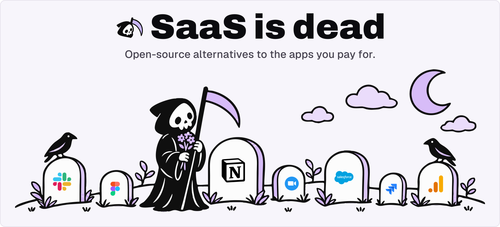
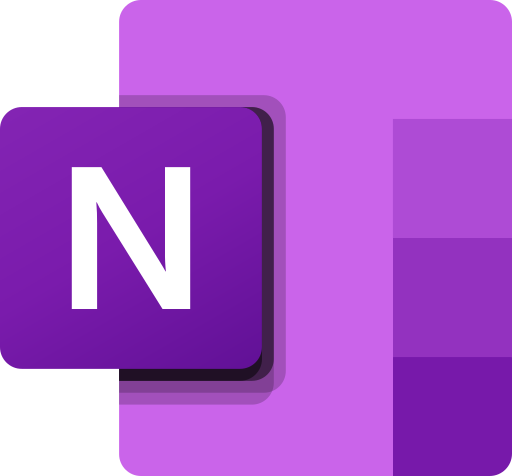

  &nbsp;
  &nbsp;
  

A hand-picked catalog of open-source projects that replace paid SaaS, grouped by the product they replace. Every entry is reviewed by hand. The same catalog, with live GitHub stars, growth and launch dates, lives at **[saasisdead.si](https://saasisdead.si)**.

## How to add a project

1. Find the category and the paid product your project replaces. If the product is missing, add a `### Product` heading in the right category.
2. Add one bullet in alphabetical order: `- [Name](https://github.com/owner/repo) - What it does in one sentence.`
3. Open a pull request. Accepted projects are added to [saasisdead.si](https://saasisdead.si) too.

Read the [contributing guide](CONTRIBUTING.md) for what gets in. No time for a pull request? [Suggest a project](https://github.com/tonyzedginidze/saasisdead/issues/new?template=suggest-project.yml) instead.

## Contents

  
  
   
  
  
   
  
  
   
  
  
   
  
  
   
  
  
   

## AI & Agents

### <picture><source media="(prefers-color-scheme: dark)" srcset="assets/logos/braintrust-dark.svg"></picture>&nbsp; Braintrust

- [DeepEval](https://github.com/confident-ai/deepeval) - The LLM Evaluation Framework. Also replaces Galileo.
- [Opik](https://github.com/comet-ml/opik) - Debug, evaluate, and monitor your LLM applications, RAG systems, and agentic workflows with comprehensive tracing, automated evaluations, and. Also replaces LangSmith.

### &nbsp; Chatbase

- [LangBot](https://github.com/langbot-app/LangBot) - Production-grade platform for building agentic IM bots - 生产级多平台智能机器人开发平台/ Agent、知识库编排、插件系统 / Bots for Discord / Slack / LINE / Telegram /. Also replaces Tidio.
- [Pipecat](https://github.com/pipecat-ai/pipecat) - Open Source framework for voice agents, multimodal apps, and realtime AI. Maintained by Daily and the community.

### &nbsp; ChatGPT

- [Chat UI](https://github.com/huggingface/chat-ui) - The open source codebase powering HuggingChat.
- [Chatbox](https://github.com/chatboxai/chatbox) - Powerful AI Client. Also replaces Claude.
- [LibreChat](https://github.com/LibreChat-AI/LibreChat) - Enhanced ChatGPT Clone: Features Agents, MCP, Skills, DeepSeek, Anthropic, AWS, OpenAI, Responses API, Azure, Groq, o1, GPT-5, Mistral. Also replaces Claude, Gemini, Grok, Poe, T3 Chat, TypingMind, Chatbase, Tidio.
- [SillyTavern](https://github.com/SillyTavern/SillyTavern) - LLM Frontend for Power Users.

### &nbsp; Claude

- [5ire](https://github.com/nanbingxyz/5ire) - Smart desktop AI assistant with powerful local knowledge features. Also replaces ChatGPT, LM Studio, TypingMind, Poe.
- [agentconnect](https://github.com/agentconnect-md/agentconnect) - The open-source, multi-agent alternative to Claude Tag. @ any agent, wherever work happens, they work alongside your team, learning as they go.
- [AnythingLLM](https://github.com/mintplex-labs/anything-llm) - Chat with your documents using any LLM, fully private. Also replaces ChatGPT, TypingMind, Poe, T3 Chat, Perplexity, NotebookLM.
- [Cherry Studio](https://github.com/cherryhq/cherry-studio) - Multi-model AI desktop client with local-first privacy. Also replaces ChatGPT, LM Studio, TypingMind, Poe, T3 Chat.
- [Jan](https://github.com/janhq/jan) - Run AI models locally or connect to cloud, privately. Also replaces ChatGPT, Gemini, Grok, LM Studio, TypingMind, Poe, T3 Chat.
- [Khoj](https://github.com/khoj-ai/khoj) - AI second brain for research, automation, and personal agents. Also replaces ChatGPT, Perplexity, NotebookLM.
- [LobeChat](https://github.com/lobehub/lobehub) - Manage, build, and run AI agent teams around the clock. Also replaces ChatGPT, Gemini, Claude Cowork, TypingMind, Poe, Manus, T3 Chat.
- [Morphic](https://github.com/miurla/morphic) - AI-powered answer engine with dynamic interface generation. Also replaces ChatGPT, Perplexity, v0.
- [omnara](https://github.com/omnara-ai/omnara) - The open-source managed agent platform. A self-hostable alternative to Claude Managed Agents and OpenAI's Agents API.
- [Open WebUI](https://github.com/open-webui/open-webui) - One interface for every AI model you run or connect. Also replaces ChatGPT, Gemini, Grok, Perplexity, TypingMind, Poe, T3 Chat, NotebookLM.

### &nbsp; Claude Code

- [Aider](https://github.com/aider-ai/aider) - AI pair programmer that works inside your terminal. Also replaces OpenAI Codex, Cursor, Kiro, GitHub Copilot, Qoder, Zencoder, Devin, Windsurf, Factory, CodeGPT, Amp, Trae.
- [Cline](https://github.com/cline/cline) - Open-source AI coding agent for your editor and terminal. Also replaces OpenAI Codex, Cursor, Google Antigravity, GitHub Copilot, Zencoder, Devin, Factory, CodeGPT, Amp, Tabnine, Jules, Trae.
- [Codex CLI](https://github.com/openai/codex) - AI coding agent that works inside your terminal. Also replaces Cursor, GitHub Copilot, Windsurf, Devin.
- [Crush](https://github.com/charmbracelet/crush) - Glamourous agentic coding for all.
- [Forgecode](https://github.com/tailcallhq/forgecode) - Terminal-native AI coding agent built on ZSH. Also replaces OpenAI Codex, Cursor, Warp, GitHub Copilot, Qoder, Zencoder, Devin, CodeGPT, Amp, Trae.
- [Gemini CLI](https://github.com/google-gemini/gemini-cli) - An open-source AI agent that brings the power of Gemini directly into your terminal. Also replaces OpenAI Codex.
- [Goose](https://github.com/aaif-goose/goose) - General-purpose AI agent for code, workflows, and more. Also replaces OpenAI Codex, Claude Cowork, Devin, Cursor.
- [Grok Build](https://github.com/xai-org/grok-build) - AI coding agent and CLI for complex terminal workflows. Also replaces OpenAI Codex, Warp, Zencoder, Devin, Factory, CodeGPT, Amp.
- [Jean](https://github.com/coollabsio/jean) - Parallel AI agent workspaces with Git and project context. Also replaces OpenAI Codex, Cursor, Warp, Kiro, Zencoder, Jules.
- [Kilo](https://github.com/kilo-org/kilocode) - AI coding agent for VS Code, JetBrains, CLI, and Cloud. Also replaces OpenAI Codex, Cursor, Google Antigravity, Kiro, GitHub Copilot, Qoder, Zencoder, Windsurf, Factory, CodeGPT, Amp, Tabnine.
- [Open Interpreter](https://github.com/openinterpreter/openinterpreter) - Coding agent that runs on local and open-weight models. Also replaces OpenAI Codex, Devin.
- [OpenCode](https://github.com/sst/opencode) - AI coding agent for terminal, IDE, and desktop. Also replaces OpenAI Codex, Google Antigravity, Zencoder, Devin, Factory, CodeGPT, Amp, Jules, Tabnine.
- [OpenCode](https://github.com/anomalyco/opencode) - The open source coding agent. Also replaces OpenAI Codex, Cursor.
- [OpenHands](https://github.com/openhands/openhands) - Autonomous coding agents that complete real engineering tasks. Also replaces OpenAI Codex, Qoder, Zencoder, Devin, Factory, CodeGPT, Amp, Jules, Manus, Cursor.
- [Paseo](https://github.com/getpaseo/paseo) - Run coding agents from your phone, desktop, or terminal. Also replaces OpenAI Codex, Cursor, Warp, Kiro, Zencoder.
- [pi](https://github.com/earendil-works/pi) - Minimal terminal coding agent you can fully customize. Also replaces OpenAI Codex, Warp, Google Antigravity, Zencoder, Amp, Tabnine, Trae.
- [Qwen Code](https://github.com/QwenLM/qwen-code) - Open source AI coding agent for the terminal and IDE. Also replaces OpenAI Codex, Cursor, GitHub Copilot.
- [Synara](https://github.com/Emanuele-web04/synara) - Code with Claude, Codex, Gemini, and more in one workspace. Also replaces OpenAI Codex, Warp, Kiro, Zencoder.
- [T3 Code](https://github.com/pingdotgg/t3code) - AI-powered coding made simple and efficient. Also replaces OpenAI Codex, Warp, Kiro, Zencoder.
- [Zero](https://github.com/Gitlawb/zero) - Terminal coding agent with full model and data control. Also replaces OpenAI Codex, Google Antigravity, Amp.

### &nbsp; Claude Cowork

- [Agenta](https://github.com/agenta-ai/agenta) - Build, automate, and improve AI agents with your team. Also replaces Lindy.
- [AionUi](https://github.com/iOfficeAI/AionUi) - Open-source 24/7 Cowork app for OpenClaw, Hermes, Claude Code, Codex, OpenCode and 20+ more CLI Agent | Customize your assistants | Team them up｜. Also replaces Manus.
- [kuse_cowork](https://github.com/kuse-ai/kuse_cowork) - Open-source Alternative to Claude Cowork Desktop App By Kuse.
- [open-dots](https://github.com/Anil-matcha/open-dots) - Open-source, self-hosted alternative to Claude Duet: AI coworkers (named agents) with instructions, memory, routines, their own isolated computer. Also replaces Grok.

### &nbsp; Cluely

- [cue](https://github.com/Blueturboguy07/cue) - Open-source macOS AI copilot that floats over your screen, sees/hears your meetings, and stays hidden from screen shares.
- [natively-cluely-ai-assistant](https://github.com/Natively-AI-assistant/natively-cluely-ai-assistant) - Natively — Free open-source AI meeting assistant, interview copilot, and note taker. Also replaces Otter.ai, Granola, Fireflies.ai.
- [pluely](https://github.com/iamsrikanthnani/pluely) - The Open Source Alternative to Cluely - A lightning-fast, privacy-first AI assistant that works seamlessly during meetings, interviews, and.

### &nbsp; CodeRabbit

- [Continue](https://github.com/continuedev/continue) - Open-source coding agent for your IDE and terminal. Also replaces Greptile, Qodo, GitHub Copilot, Cursor.
- [Kodus](https://github.com/kodustech/kodus-ai) - AI code review that learns your team's standards. Also replaces Greptile, Qodo.
- [Pullfrog](https://github.com/pullfrog/pullfrog) - AI agent workflows built natively into GitHub. Also replaces Greptile, Factory, Qodo, Jules.

### <picture><source media="(prefers-color-scheme: dark)" srcset="assets/logos/cursor-dark.svg"></picture>&nbsp; Cursor

- [Athas](https://github.com/athasdev/athas) - Lightweight code editor with agents, Git, and terminal built in. Also replaces Google Antigravity, Kiro, Qoder, JetBrains IDEs, Windsurf.
- [CodeEdit](https://github.com/codeeditapp/codeedit) - A native code editor for macOS. Also replaces Google Antigravity, Kiro, JetBrains IDEs, Windsurf.
- [Neovim](https://github.com/neovim/neovim) - Hyperextensible, Lua-powered Vim-based text editor. Also replaces JetBrains IDEs, Windsurf.
- [Zed](https://github.com/zed-industries/zed) - High-performance code editor built for speed and AI. Also replaces Google Antigravity, Kiro, Qoder, JetBrains IDEs, Windsurf, GitHub Copilot.

### <picture><source media="(prefers-color-scheme: dark)" srcset="assets/logos/elevenlabs-dark.svg"></picture>&nbsp; ElevenLabs

- [Chatterbox](https://github.com/resemble-ai/chatterbox) - SoTA open-source TTS.
- [CosyVoice](https://github.com/QwenAudio/CosyVoice) - Multi-lingual large voice generation model, providing inference, training and deployment full-stack ability.
- [F5-TTS](https://github.com/SWivid/F5-TTS) - Official code for "F5-TTS: A Fairytaler that Fakes Fluent and Faithful Speech with Flow Matching".
- [Fish Speech](https://github.com/fishaudio/fish-speech) - SOTA Open Source TTS.
- [GPT-SoVITS](https://github.com/RVC-Boss/GPT-SoVITS) - 1 min voice data can also be used to train a good TTS model! (few shot voice cloning).
- [IndexTTS](https://github.com/index-tts/index-tts) - An Industrial-Level Controllable and Efficient Zero-Shot Text-To-Speech System.
- [OmniVoice](https://github.com/k2-fsa/OmniVoice) - High-Quality Voice Cloning TTS for 600+ Languages.
- [Piper](https://github.com/OHF-Voice/piper1-gpl) - Fast and local neural text-to-speech engine.
- [Qwen3-TTS](https://github.com/QwenLM/Qwen3-TTS) - An open-source series of TTS models developed by the Qwen team at Alibaba Cloud, supporting stable, expressive, and streaming speech generation.
- [Voicebox](https://github.com/jamiepine/voicebox) - The open-source AI voice studio. Clone, dictate, create.
- [VoiceStudio](https://github.com/debpalash/VoiceStudio) - The open-source, fully-local ElevenLabs alternative — voice cloning, voice design, video dubbing, dictation, transcription & audiobook creation in.
- [VoxCPM](https://github.com/OpenBMB/VoxCPM) - VoxCPM2: Tokenizer-Free TTS for Multilingual Speech Generation, Creative Voice Design, and True-to-Life Cloning.

### Fireflies.ai

- [Vexa](https://github.com/Vexa-ai/vexa) - Open-source meeting transcription API for Google Meet, Microsoft Teams & Zoom. Also replaces Otter.ai.

### &nbsp; Gamma

- [banana-slides](https://github.com/Anionex/banana-slides) - 一站式原生AI PPT生成应用，几分钟内生成一套幻灯片; 支持上传任意模板图片，上传任意素材&智能解析，一句话/大纲/页面描述自动生成PPT，口头修改指定区域、一键导出可编辑ppt、视频等 - An AI-native slides generator based on nano banana/gpt-image.
- [Codex PPT Skill](https://github.com/ningzimu/codex-ppt-skill) - GPT-Image-2 PPT Generator Skill for Creating Image-Based PowerPoint Presentations in Codex and Other Skill-Compatible Agents.
- [GenOffice](https://github.com/genspark-ai/genoffice) - Free, open-source AI Office suite: Docs, Sheets, Slides, PDF, Markdown and HTML editors with a built-in AI agent, plus a `genoffice` CLI and agent. Also replaces Canva, Microsoft 365, Google Workspace.
- [oh-my-ppt](https://github.com/arcsin1/oh-my-ppt) - Describe what you need — a presentation, lesson, or story — and let the AI build clean, beautiful HTML slides for you.
- [PPT Master](https://github.com/hugohe3/ppt-master) - AI turns documents or topics into real, native PowerPoint decks—with native shapes, transitions and animations, data-backed charts and tables on.
- [PPTAgent](https://github.com/icip-cas/PPTAgent) - An Agentic Framework for Reflective PowerPoint Generation.
- [Presentation AI](https://github.com/allweonedev/presentation-ai) - ALLWEONE Open source AI presentation generator Gamma Alternative.
- [Presenton](https://github.com/presenton/presenton) - Open-Source AI Presentation Generator and API (Gamma, Canva, Beautiful AI, Decktopus, Presentations AI Alternative). Also replaces Canva.

### <picture><source media="(prefers-color-scheme: dark)" srcset="assets/logos/granola-dark.svg"></picture>&nbsp; Granola

- [Anarlog](https://github.com/fastrepl/anarlog) - Private meeting notes, no bots, files you own. Also replaces Otter.ai, tl;dv, Fireflies.ai, Fathom, Fellow.
- [Meetily](https://github.com/Zackriya-Solutions/meetily) - Local AI meeting transcription with zero data leaving your device. Also replaces Otter.ai, tl;dv, Fireflies.ai, Fathom, Fellow.
- [Minutes](https://github.com/silverstein/minutes) - Local meeting recorder that keeps your audio off the cloud. Also replaces Otter.ai, tl;dv, Fireflies.ai, Fathom, Fellow.
- [Steno](https://github.com/stenolabs/stenoai) - StenographAI is the secure privacy-first AI notepad & notetaker for confidential conversations in government & defence sectors. Also replaces Otter.ai.

### <picture><source media="(prefers-color-scheme: dark)" srcset="assets/logos/grok-dark.svg"></picture>&nbsp; Grok

- [Eigent](https://github.com/eigent-ai/eigent) - Desktop multi-agent workforce for automating real tasks. Also replaces Claude Cowork, Manus, OpenAI Codex.
- [Hermes Agent](https://github.com/nousresearch/hermes-agent) - Desktop AI agent with persistent memory across platforms. Also replaces Lindy, Manus.
- [MausBot](https://github.com/milind-soni/OpenMausBot) - A team of AI agents in a chat app, on your own machine.
- [NanoClaw](https://github.com/nanocoai/nanoclaw) - Personal AI agent for messaging apps, containerized.
- [open-duet](https://github.com/Anil-matcha/open-duet) - Open-source, self-hosted alternative to Claude Duet: AI coworkers (named agents) with instructions, memory, routines, their own isolated computer. Also replaces ChatGPT, Claude, Manus.
- [OpenBot](https://github.com/CopilotKit/openbot) - Self-hosted enterprise agent platform with real permissions.
- [OpenClaw](https://github.com/openclaw/openclaw) - An AI assistant that acts, not just answers. Also replaces Manus, Claude Cowork.
- [OpenWork](https://github.com/different-ai/openwork) - Multi-model AI workspace with org-wide skill sharing. Also replaces Claude Cowork.
- [Rakazo](https://github.com/elie222/rakazo) - Self-hosted AI agents that do real work on your machine.
- [rome](https://github.com/rome-os/rome) - A compounding agent OS for recursive agents. Also an open source alternative to Grok Bot and Meta's Muse.

### &nbsp; Kiro

- [Agno](https://github.com/agno-agi/agno) - Model-agnostic platform for building intelligent AI agents.

### &nbsp; LangSmith

- [AgentOps](https://github.com/AgentOps-AI/agentops) - Python SDK for AI agent monitoring, LLM cost tracking, benchmarking, and more. Also replaces Braintrust.
- [Arize Phoenix](https://github.com/arize-ai/phoenix) - Open-source LLM tracing & evaluation for AI optimization. Also replaces Braintrust, Galileo, Weights & Biases, Arize AI.
- [Langfuse](https://github.com/langfuse/langfuse) - Open source LLM engineering platform for AI-powered applications. Also replaces Braintrust, Galileo, Weights & Biases, Arize AI.
- [LangWatch](https://github.com/langwatch/langwatch) - Simulation-based testing and evaluation for AI agents. Also replaces Braintrust, Galileo, Weights & Biases, Arize AI.
- [Latitude](https://github.com/latitude-dev/latitude-llm) - Full observability for AI agents in production. Also replaces Braintrust, Galileo, Weights & Biases, Arize AI.
- [OpenLIT](https://github.com/openlit/openlit) - Monitor, debug, and scale LLM applications with ease. Also replaces Weights & Biases, Galileo, Arize AI.

### &nbsp; Lindy

- [AutoGPT](https://github.com/Significant-Gravitas/AutoGPT) - Build and run AI agents that handle recurring work for you.
- [Paperclip](https://github.com/paperclipai/paperclip) - Org chart, budgets, and governance for AI agent teams.

### <picture><source media="(prefers-color-scheme: dark)" srcset="assets/logos/lm-studio-dark.svg"></picture>&nbsp; LM Studio

- [llama.cpp](https://github.com/ggml-org/llama.cpp) - Run LLMs locally with minimal setup, maximum hardware support.
- [LocalAI](https://github.com/mudler/LocalAI) - Self-hosted AI runtime for text, voice, vision, and agents.
- [Ollama](https://github.com/ollama/ollama) - Run open-source LLMs locally on your own machine. Also replaces ChatGPT.

### &nbsp; Lovable

- [bolt.diy](https://github.com/stackblitz-labs/bolt.diy) - Prompt, run, edit, and deploy full-stack web applications using any LLM you want! Also replaces v0.
- [Dyad](https://github.com/dyad-sh/dyad) - Build unlimited AI apps locally with zero vendor lock-in. Also replaces v0.
- [Onlook](https://github.com/onlook-dev/onlook) - The Developer Tool for Visual Engineers • An Open-Source AI-First Design tool • Visually build, style, and edit your code with AI • World's best. Also replaces v0.
- [Open Lovable](https://github.com/firecrawl/open-lovable) - Clone and recreate any website as a modern React app in seconds.
- [Reflex](https://github.com/reflex-dev/reflex) - Full-stack Python platform for web apps and internal tools. Also replaces v0.

### <picture><source media="(prefers-color-scheme: dark)" srcset="assets/logos/manus-dark.svg"></picture>&nbsp; Manus

- [Agent Zero](https://github.com/agent0ai/agent-zero) - Agentic AI framework that runs, learns, and self-corrects. Also replaces Claude Cowork.
- [IronClaw](https://github.com/nearai/ironclaw) - AI agent runtime with encrypted enclaves for your secrets.
- [Kortix](https://github.com/kortix-ai/suna) - AI workforce platform where agents, skills, and memory live in your repo.
- [lemonai](https://github.com/hexdocom/lemonai) - Lemon AI is the first Full-stack Open-source Self-Evolving General AI Agent, offering a fully local alternative to Agentic platforms like Manus &.
- [nanobot](https://github.com/HKUDS/nanobot) - Self-hosted AI agent for chat, automation, and workflows.
- [ZeroClaw](https://github.com/zeroclaw-labs/zeroclaw) - Self-hosted AI agent with 70+ providers and 30+ channels.

### <picture><source media="(prefers-color-scheme: dark)" srcset="assets/logos/midjourney-dark.svg"></picture>&nbsp; Midjourney

- [ComfyUI](https://github.com/comfyanonymous/ComfyUI) - The most powerful and modular diffusion model GUI, api and backend with a graph/nodes interface. The fastest local inference engine in the world.
- [ComfyUI](https://github.com/Comfy-Org/ComfyUI) - The most powerful and modular diffusion model GUI, api and backend with a graph/nodes interface. The fastest local inference engine in the world. Also replaces Leonardo AI, Runway.
- [InvokeAI](https://github.com/invoke-ai/InvokeAI) - Invoke is a leading creative engine for Stable Diffusion models, empowering professionals, artists, and enthusiasts to generate and create visual. Also replaces Leonardo AI.
- [Krita AI Diffusion](https://github.com/Acly/krita-ai-diffusion) - Streamlined interface for generating images with AI in Krita. Inpaint and outpaint with optional text prompt, no tweaking required. Also replaces Leonardo AI.
- [Open-Generative-AI](https://github.com/Anil-matcha/Open-Generative-AI) - Unrestricted Open-source alternative to AI video platforms — Free AI image & video generation studio with 600+ models (Flux, Midjourney, Kling. Also replaces Leonardo AI, Runway.
- [Pollinations](https://github.com/pollinations/pollinations) - Your Friendly Open-Source Gen-AI Platform.
- [SD.Next](https://github.com/vladmandic/sdnext) - All-in-one WebUI for AI generative image and video creation, captioning and processing.
- [Stable Diffusion WebUI](https://github.com/AUTOMATIC1111/stable-diffusion-webui) - Stable Diffusion web UI.
- [SwarmUI](https://github.com/mcmonkeyprojects/SwarmUI) - SwarmUI (formerly StableSwarmUI), A Modular Stable Diffusion Web-User-Interface, with an emphasis on making powertools easily accessible, high. Also replaces Leonardo AI.

### <picture><source media="(prefers-color-scheme: dark)" srcset="assets/logos/notebooklm-dark.svg"></picture>&nbsp; NotebookLM

- [Deta Surf](https://github.com/deta/surf) - Browser and notebook combined with local-first AI. Also replaces Comet, Roam Research.
- [Kotaemon](https://github.com/Cinnamon/kotaemon) - An open-source RAG-based tool for chatting with your documents.
- [LightRAG](https://github.com/HKUDS/LightRAG) - [EMNLP2025] LightRAG: Simple and Fast Retrieval-Augmented Generation.
- [notebookllama](https://github.com/run-llama/notebookllama) - A fully open-source, LlamaCloud-backed alternative to NotebookLM.
- [Open-Notebook](https://github.com/lfnovo/open-notebook) - AI-powered research notebook with full privacy control. Also replaces Roam Research.
- [Podcastfy](https://github.com/souzatharsis/podcastfy) - An Open Source Python alternative to NotebookLM's podcast feature: Transforming Multimodal Content into Captivating Multilingual Audio.
- [RAGFlow](https://github.com/infiniflow/ragflow) - A leading open-source Retrieval-Augmented Generation (RAG) engine that fuses cutting-edge RAG with Agent capabilities to create a superior context.
- [SurfSense](https://github.com/modsetter/surfsense) - Privacy-first knowledge base with any AI model you choose. Also replaces Perplexity.

### &nbsp; OpenAI Codex

- [Emdash](https://github.com/generalaction/emdash) - Dashboard for running multiple coding agents in parallel. Also replaces Warp, Kiro, Zencoder.
- [open-computer-use](https://github.com/iFurySt/open-computer-use) - Open Computer Use – Open-Source Alternative to Codex Computer Use.
- [Orca](https://github.com/stablyai/orca) - Run multiple AI coding agents in parallel, side by side. Also replaces Warp, Kiro, Zencoder.
- [Superset](https://github.com/superset-sh/superset) - Run dozens of AI coding agents in parallel on your machine. Also replaces Warp, Kiro, Zencoder.
- [Tabby](https://github.com/tabbyml/tabby) - AI-powered code completion for seamless development. Also replaces Cursor, Kiro, GitHub Copilot, Qoder, Zencoder, Windsurf, CodeGPT, Tabnine.

### &nbsp; OpenAI Operator

- [Agent S](https://github.com/simular-ai/Agent-S) - The state-of-the-art open source computer use agents. Also replaces Claude Cowork.
- [CUA](https://github.com/trycua/cua) - Scale computer-use 2.0 with open-source drivers, cross-OS sandboxes, and benchmarks for training, evaluation, and data generation. Also replaces Manus.
- [UI-TARS Desktop](https://github.com/bytedance/UI-TARS-desktop) - The Open-Source Multimodal AI Agent Stack: Connecting Cutting-Edge AI Models and Agent Infra. Also replaces Claude Cowork.

### <picture><source media="(prefers-color-scheme: dark)" srcset="assets/logos/openrouter-dark.svg"></picture>&nbsp; OpenRouter

- [Bifrost](https://github.com/maximhq/bifrost) - Ultra-fast AI gateway with enterprise-grade reliability.
- [LiteLLM](https://github.com/berriai/litellm) - LLM gateway for auth, load balancing, and spend tracking.
- [LLM Gateway](https://github.com/theopenco/llmgateway) - Unified API for all LLM providers with analytics.
- [Portkey Gateway](https://github.com/Portkey-AI/gateway) - A blazing fast AI Gateway with integrated guardrails. Route to 1,600+ LLMs, 50+ AI Guardrails with 1 fast & friendly API.

### Otter.ai

- [Speakr](https://github.com/murtaza-nasir/speakr) - A personal, self-hosted web application designed for transcribing audio recordings. Also replaces Fireflies.ai.
- [Vibe](https://github.com/thewh1teagle/vibe) - Transcribe on your own!

### &nbsp; Perplexity

- [GPT Researcher](https://github.com/assafelovic/gpt-researcher) - An autonomous agent that conducts deep research on any data using any LLM providers.
- [Inkeep Agents](https://github.com/inkeep/agents) - Create AI Agents in a No-Code Visual Builder or TypeScript SDK with full 2-way sync. For shipping AI assistants and multi-agent AI workflows.
- [Vane](https://github.com/ItzCrazyKns/Vane) - An AI-powered answering engine.

### &nbsp; Sudowrite

- [Easy Writing](https://github.com/yilujian/easy-writing) - 易创：纯本地、开源的 AI 网文写作桌面软件，支持小说创作、AI 辅助写作、BYOK 与自定义提示词。.
- [MuMuAINovel](https://github.com/xiamuceer-j/MuMuAINovel) - 一款基于 AI 的智能小说创作助手，帮助你轻松创作精彩故事.
- [Pagekin](https://github.com/EthanYoQ/AI-Novel-Writer) - 书童 Pagekin（原名 AI 小说作家）：开源免费的 AI 长篇小说写作桌面软件，从设定、蓝图到正文、审稿、定稿；支持拆解仿写、续写、改写，可导入写作 Skill（如去 AI 味）。模型需自行配置，作品在本地。Pagekin (formerly AI Novel Writer): free, open-source AI novel writing app for long novels and web fiction. Imitate, continue, rewrite; import writing skills. Local-first, no model bundled. Windows & macOS.
- [Show Me the Story](https://github.com/Nigh/show-me-the-story) - <10 MB — self-hosted AI novel writer in a single Go binary with a web UI.

### <picture><source media="(prefers-color-scheme: dark)" srcset="assets/logos/suno-dark.svg"></picture>&nbsp; Suno

- [ACE-Step 1.5](https://github.com/ace-step/ACE-Step-1.5) - The most powerful local music generation model that outperforms almost all commercial alternatives, supporting Mac, AMD, Intel, and CUDA devices. Also replaces Udio.
- [MusicGen](https://github.com/facebookresearch/audiocraft) - Audiocraft is a library for audio processing and generation with deep learning.
- [YoVoice](https://github.com/leemysw/yovoice) - Open-source local AI audio & music studio for macOS & Windows. Also replaces Udio.
- [YuE](https://github.com/multimodal-art-projection/YuE) - YuE2: frontier music generation with symbolic planning, zero-shot covers, and agentic music editing. Also replaces Udio.

### &nbsp; Superwhisper

- [VoiceInk](https://github.com/Beingpax/VoiceInk) - The best open-source alternative to Superwhisper & Wispr Flow. Voice-to-text app for macOS with no subscription. Also replaces Wispr Flow.

### &nbsp; Tavily

- [OpenSERP](https://github.com/karust/openserp) - Self-hosted SERP API for Google, Bing, Yandex, and more.
- [Swirl Search](https://github.com/swirlai/swirl-search) - Get instant answers from your company knowledge. Also replaces Algolia, Coveo.

### &nbsp; Voiceflow

- [Dograh](https://github.com/dograh-hq/dograh) - Self-hostable voice agent platform with full model control.
- [LiveKit](https://github.com/livekit/livekit) - Full-stack platform for voice, video, and physical AI agents.

### &nbsp; Wispr Flow

- [Amical](https://github.com/amicalhq/amical) - Type 10x faster with AI-powered voice dictation. Also replaces Superwhisper, Typeless, Aqua Voice.
- [FluidVoice](https://github.com/altic-dev/FluidVoice) - On-device voice dictation for macOS with adaptive AI. Also replaces Superwhisper, Typeless, Aqua Voice.
- [freeflow](https://github.com/zachlatta/freeflow) - Free & fast alternative to Wispr Flow.
- [Handy](https://github.com/cjpais/handy) - Press a key, speak, release. Text appears instantly. Also replaces Superwhisper, Typeless, Aqua Voice.
- [Jarvis](https://github.com/akshayaggarwal99/jarvis-ai-assistant) - Dictate faster and control your Mac with voice. Also replaces Superwhisper, Typeless, Voiceflow, Aqua Voice.
- [OpenWhispr](https://github.com/OpenWhispr/openwhispr) - Voice-to-text dictation app with local (Nvidia Parakeet/Whisper) and cloud models (BYOK). Privacy-first and available cross-platform.
- [OpenWispr](https://github.com/herotools/open-wispr) - Voice-to-text that works offline, privately, on any app. Also replaces Superwhisper, Typeless, Aqua Voice.

### &nbsp; Zencoder

- [SWE-agent](https://github.com/swe-agent/swe-agent) - AI agents that autonomously fix code and resolve GitHub issues. Also replaces Devin, Factory, CodeGPT, Jules.

[Back to contents](#contents)

## Productivity & Notes

### &nbsp; Airtable

- [AITable](https://github.com/apitable/apitable) - Visual database for workflow automation across apps. Also replaces Coda, Softr, Glide, Stackby.
- [Baserow](https://github.com/bram2w/baserow) - Build databases, automations, apps & agents with AI — no code.
- [Grist](https://github.com/gristlabs/grist-core) - Flexible spreadsheets with database power. Also replaces Microsoft Excel, Google Sheets, Softr, Glide, Stackby, Smartsheet.
- [Mathesar](https://github.com/mathesar-foundation/mathesar) - Spreadsheet-like interface for PostgreSQL databases. Also replaces Google Sheets, Retool, Softr, Glide, Stackby.
- [NocoBase](https://github.com/nocobase/nocobase) - Build custom apps without code, deploy with ease. Also replaces Power Apps, Retool, AppSheet, Appian, Mendix, OutSystems, Stackby.
- [NocoDB](https://github.com/nocodb/nocodb) - Transform databases into intuitive spreadsheets instantly. Also replaces Google Sheets, Retool, Softr, Glide, Stackby, Firebase.
- [Saltcorn](https://github.com/saltcorn/saltcorn) - Free and open source no-code application builder.
- [Teable](https://github.com/teableio/teable) - Flexible database meets intuitive spreadsheet interface. Also replaces Microsoft Excel, Google Sheets, Hex, Mode, Stackby, Glide, Softr.

### &nbsp; Calendly

- [Cal.com](https://github.com/calcom/cal.diy) - Self-host your own scheduling page, no vendor required. Also replaces Doodle, Clockwise, SavvyCal.
- [Cal.com](https://github.com/calcom/cal.com) - Scheduling infrastructure for absolutely everyone.
- [Easy!Appointments](https://github.com/alextselegidis/easyappointments) - Free open-source appointment booking for any business. Also replaces Doodle, Clockwise, SavvyCal.
- [Nextcloud Calendar](https://github.com/nextcloud/calendar) - Calendar app for Nextcloud.
- [Rallly](https://github.com/lukevella/rallly) - Effortless group scheduling for seamless collaboration. Also replaces Doodle, Clockwise, SavvyCal.
- [Timeful](https://github.com/schej-it/timeful.app) - Timeful (formerly Schej) is a scheduling platform helps you find the best time for a group to meet. Also replaces Doodle.

### &nbsp; Clockify

- [Kimai](https://github.com/kimai/kimai) - Effortless time tracking for teams and projects. Also replaces Toggl Track, Harvest, TimeCamp.
- [SolidTime](https://github.com/solidtime-io/solidtime) - Effortless time tracking for open source projects. Also replaces Toggl Track, Harvest, WakaTime, TimeCamp.
- [Traggo](https://github.com/traggo/server) - Self-hosted tag-based time tracking.
- [Wakapi](https://github.com/muety/wakapi) - Track coding time effortlessly, gain insights instantly. Also replaces Toggl Track, Harvest, WakaTime, TimeCamp.

### &nbsp; Confluence

- [BookStack](https://github.com/BookStackApp/BookStack) - NOW MANAGED ON CODEBERG. Also replaces Slite, Nuclino, Document360, GitBook.
- [DokuWiki](https://github.com/dokuwiki/dokuwiki) - The DokuWiki Open Source Wiki Engine. Also replaces Slite, Document360.
- [MediaWiki](https://github.com/wikimedia/mediawiki) - The collaborative editing software that runs Wikipedia. Also replaces GitBook, Guru, Document360.
- [Wiki.js](https://github.com/requarks/wiki) - Next Generation Open Source Wiki. Also replaces GitBook, Notion, Document360.

### &nbsp; DocuSign

- [Documenso](https://github.com/documenso/documenso) - Secure, open-source document signing for everyone. Also replaces PandaDoc.
- [Docuseal](https://github.com/docusealco/docuseal) - Legally binding document signing for individuals and teams. Also replaces PandaDoc.
- [OpenSign](https://github.com/OpenSignLabs/OpenSign) - Secure, customizable e-signatures for modern businesses. Also replaces PandaDoc.
- [Stirling PDF](https://github.com/Stirling-Tools/Stirling-PDF) - #1 PDF Application on GitHub that lets you edit PDFs on any device anywhere. Also replaces Adobe Acrobat.

### &nbsp; Google Forms

- [Formbricks](https://github.com/formbricks/formbricks) - Privacy-first survey and experience management platform. Also replaces Tally, Typeform, Jotform, Fillout, Youform, Qualtrics.
- [HeyForm](https://github.com/heyform/heyform) - Create powerful forms with ease and flexibility. Also replaces Tally, Typeform, Jotform, Fillout, Youform, Qualtrics.
- [LimeSurvey](https://github.com/LimeSurvey/LimeSurvey) - Create engaging surveys and gather valuable insights. Also replaces Tally, Typeform, Jotform, Youform, Fillout, Qualtrics, SurveyMonkey.
- [OpnForm](https://github.com/JhumanJ/opnform) - Create powerful forms with ease and flexibility. Also replaces Tally, Typeform, Jotform, Fillout, Youform, Qualtrics.

### &nbsp; Grammarly

- [Harper](https://github.com/Automattic/harper) - Offline, privacy-first grammar checker. Fast, open-source, Rust-powered.
- [Humanizer](https://github.com/blader/humanizer) - Agent skill that removes signs of AI-generated writing from text.
- [LanguageTool](https://github.com/languagetool-org/languagetool) - Style and Grammar Checker for 25+ Languages.
- [Vale](https://github.com/vale-cli/vale) - Pencil: A markup-aware linter for prose built with speed and extensibility in mind.
- [WritingTools](https://github.com/theJayTea/WritingTools) - The world's smartest system-wide grammar assistant; a better version of the Apple Intelligence Writing Tools.

### &nbsp; Guru

- [Pipeshub](https://github.com/pipeshub-ai/pipeshub-ai) - Enterprise workplace AI with data you own and control.

### <picture><source media="(prefers-color-scheme: dark)" srcset="assets/logos/ifttt-dark.svg"></picture>&nbsp; IFTTT

- [Node-RED](https://github.com/node-red/node-red) - Low-code programming for event-driven applications. Also replaces Zapier, Make.

### &nbsp; Jotform

- [Form.io](https://github.com/formio/formio) - A Form and Data Management Platform for Progressive Web Applications.

### &nbsp; Make

- [ActivePieces](https://github.com/activepieces/activepieces) - Automate workflows with no-code integration platform. Also replaces Zapier, Pipedream, IFTTT, Workato.
- [AppSmith](https://github.com/appsmithorg/appsmith) - Empower your team to build custom internal tools rapidly. Also replaces Power Apps, Retool, Softr, AppSheet, Appian, Mendix, OutSystems, Airtable.
- [Automa](https://github.com/automaapp/automa) - Build AI agents and RPA workflows without writing code. Also replaces Zapier, Appian.
- [Automatisch](https://github.com/automatisch/automatisch) - Open-source integration platform for seamless workflows. Also replaces Zapier, Pipedream, IFTTT, Workato.
- [ByteChef](https://github.com/bytechefhq/bytechef) - Build AI agents and automate complex workflows seamlessly. Also replaces Zapier, Workato.
- [Hatchet](https://github.com/hatchet-dev/hatchet) - Distributed task queue for background jobs and workflows. Also replaces Zapier, Retool, Pipedream, IFTTT.
- [n8n](https://github.com/n8n-io/n8n) - Visual workflow automation with code flexibility and AI agents. Also replaces Zapier, Pipedream, IFTTT, Appian, Workato.
- [Trigger](https://github.com/triggerdotdev/trigger.dev) - Run long-running AI tasks without timeouts or servers. Also replaces Zapier, Pipedream.
- [Windmill](https://github.com/windmill-labs/windmill) - Open-source workflow automation for developers. Also replaces Zapier, Retool, Pipedream, IFTTT.

### &nbsp; Microsoft 365

- [Apache OpenOffice](https://github.com/apache/openoffice) - A free desktop office suite for documents, spreadsheets and presentations.
- [DeckCraft](https://github.com/storytold/deckcraft) - Presentations and slide shows: an open-source, clean-room reimplementation of Microsoft PowerPoint in pure Rust. Part of the ArtCraft Crafting Apps.
- [ElyOffice](https://github.com/ELY-Open-Source/ElyOffice) - Ely Office: offline-first desktop apps in Rust and GPUI.
- [Euro-Office](https://github.com/Euro-Office/DocumentServer) - 
- [GridCraft](https://github.com/storytold/gridcraft) - An open-source, clean-room spreadsheet (Microsoft Excel-style) in pure Rust. By ArtCraft.
- [ONLYOFFICE Desktop](https://github.com/ONLYOFFICE/DesktopEditors) - Open-source office suite pack that comprises all the tools you need to work with documents, spreadsheets, presentations, PDFs, and PDF forms on. Also replaces PDF-XChange Editor.
- [ONLYOFFICE Docs](https://github.com/onlyoffice/documentserver) - Complete office suite for documents, spreadsheets & more. Also replaces Google Workspace, Superhuman Docs.
- [VibeOffice](https://github.com/tcchen2026/VibeOffice) - A free office suite that runs in your browser, in the 2000s style.

### &nbsp; Microsoft Excel

- [IronCalc](https://github.com/ironcalc/ironcalc) - A spreadsheet engine you can embed, self-host, or run in the browser. Also replaces Google Sheets.

### &nbsp; Microsoft To Do

- [Tasks.org](https://github.com/tasks/tasks) - Bringing Astrid Tasks back from the dead.

### &nbsp; Microsoft Word

- [Collabora Online](https://github.com/collaboraonline/online) - Open-source document editing suite for secure collaboration. Also replaces Microsoft 365, Microsoft Excel, Google Sheets, Google Docs, Google Workspace.
- [CryptPad](https://github.com/cryptpad/cryptpad) - Secure collaboration with end-to-end encryption. Also replaces Microsoft 365, Microsoft Excel, Google Sheets, Google Docs, Google Workspace.
- [LibreOffice](https://github.com/libreoffice/core) - Free office suite with Microsoft compatibility. Also replaces Microsoft 365, Google Sheets, Google Docs, Google Workspace.
- [WordCraft](https://github.com/storytold/wordcraft) - An open-source, clean-room reimplementation of Microsoft Word in pure Rust.

### <picture><source media="(prefers-color-scheme: dark)" srcset="assets/logos/notion-dark.svg"></picture>&nbsp; Notion

- [Affine](https://github.com/toeverything/AFFiNE) - Docs, whiteboards, and databases in one privacy-first workspace. Also replaces OneNote, Miro, Confluence, Evernote, Nuclino, FigJam, Mural.
- [AnyType](https://github.com/anyproto/anytype-ts) - Private workspace for notes, tasks, and databases. Also replaces Obsidian, Google Keep, Evernote, Apple Notes, Craft, Roam Research, Coda, Nuclino, Tana.
- [AppFlowy](https://github.com/appflowy-io/appflowy) - AI workspace for docs, projects, and wikis you control. Also replaces OneNote, Confluence, Evernote, Craft, Coda, Nuclino, Tana, Asana.
- [Beaver Notes](https://github.com/beaver-notes/beaver-notes) - Local-first notes app with no cloud, no AI, no tracking. Also replaces Obsidian, OneNote, Evernote, Apple Notes, Roam Research, Coda.
- [Blinko](https://github.com/blinko-space/blinko) - AI-Powered Note Taking App. Also replaces Obsidian, Evernote, Roam Research, Coda, Scrivener, Tana.
- [Busabase](https://github.com/busabase/busabase) - A verified workspace where AI agents store and build knowledge. Also replaces Airtable, Smartsheet, Stackby.
- [Colanode](https://github.com/colanode/colanode) - Self-hosted team workspace with chat, docs, and databases. Also replaces Microsoft Teams, Slack, Confluence, Coda, Nuclino, Chanty, Zoho Cliq.
- [Docmost](https://github.com/docmost/docmost) - Self-hosted wiki with AI, compliance, and real-time editing. Also replaces Obsidian, Confluence, Craft, Nuclino, Superhuman Docs, Guru, Slite, Document360.
- [Docs](https://github.com/suitenumerique/docs) - Create, edit and share documents with real-time collaboration. Also replaces Microsoft Word, Confluence, Google Docs, Craft, Coda, Nuclino, Superhuman Docs, Tana.
- [focalboard](https://github.com/mattermost-community/focalboard) - An open source, self-hosted alternative to Trello, Notion, and Asana. Also replaces Trello, Asana.
- [Huly](https://github.com/hcengineering/platform) - All-in-one workspace for project, chat, and docs. Also replaces Linear, Slack, monday.com, Confluence, Trello, Asana, Basecamp, Plaky, Chanty, Teamwork.com, Jira.
- [Logseq](https://github.com/logseq/logseq) - Privacy-first knowledge base that connects your notes. Also replaces Obsidian, Google Keep, Craft, Roam Research, Coda, Scrivener, Tana.
- [Memos](https://github.com/usememos/memos) - Self-hosted timeline for quick notes, logs, and snippets. Also replaces Obsidian, OneNote, Google Keep, Evernote, Apple Notes, Roam Research.
- [Notesnook](https://github.com/streetwriters/notesnook) - Zero-knowledge encrypted notes that sync across all devices. Also replaces Obsidian, OneNote, Google Keep, Evernote, Apple Notes, Craft, Roam Research, Tana.
- [Outline](https://github.com/outline/outline) - Fast, collaborative wiki for teams who need organized docs. Also replaces Confluence, Craft, Coda, Nuclino, Superhuman Docs, Tana, Guru, Slite, Document360.
- [Silverbullet](https://github.com/silverbulletmd/silverbullet) - Programmable notes with queries, Lua scripting, and wiki links. Also replaces Obsidian, Roam Research, Nuclino.
- [SiYuan](https://github.com/siyuan-note/siyuan) - Privacy-first knowledge management with block-level linking. Also replaces Obsidian, OneNote, Evernote, Roam Research, Coda, Nuclino.
- [XWiki](https://github.com/xwiki/xwiki-platform) - Open-source knowledge management and collaboration platform. Also replaces Obsidian, Confluence, Nuclino, Guru, Document360.

### &nbsp; Obsidian

- [edgeever](https://github.com/tianma-if/edgeever) - AI-native knowledge base & Evernote/Obsidian alternative with instant sync & native MCP. Free on Cloudflare or self-hosted via Docker.
- [Joplin](https://github.com/laurent22/joplin) - Encrypted note-taking that syncs across all your devices. Also replaces OneNote, Google Keep, Evernote, Apple Notes, Craft, Roam Research, Scrivener, Tana.
- [Standard Notes](https://github.com/standardnotes/app) - Secure, encrypted notes for your digital life. Also replaces OneNote, Google Keep, Evernote, Apple Notes, Craft, Roam Research, Scrivener, Tana.
- [Tolaria](https://github.com/refactoringhq/tolaria) - Local-first, Git-native personal knowledge base with AI. Also replaces OneNote, Google Keep, Apple Notes, Roam Research.

### &nbsp; OneNote

- [Trilium](https://github.com/TriliumNext/Trilium) - Build your personal knowledge base with Trilium Notes. Also replaces Evernote, Notion, Obsidian.
- [Zen](https://github.com/sheshbabu/zen) - Clean, distraction-free note-taking with local storage. Also replaces Google Keep, Evernote, Apple Notes.

### &nbsp; Pinboard

- [LinkAce](https://github.com/Kovah/LinkAce) - A self-hosted archive to collect links of your favorite websites. Also replaces Raindrop.io.
- [Shaarli](https://github.com/shaarli/Shaarli) - The personal, minimalist, super-fast, database free, bookmarking service - community repo.
- [Shiori](https://github.com/go-shiori/shiori) - Simple bookmark manager built with Go.

### Raindrop.io

- [Faved](https://github.com/denho/faved) - Handcrafted minimal bookmark manager with advanced tagging system. Also replaces Readwise Reader, Pinboard, Instapaper, Matter.
- [Karakeep](https://github.com/karakeep-app/karakeep) - Save links, notes, and images. AI tags them for you. Also replaces Readwise Reader, Pinboard, Instapaper, Matter.
- [Linkding](https://github.com/sissbruecker/linkding) - Self-hosted bookmark manager built for speed and simplicity. Also replaces Readwise Reader, Pinboard, Instapaper, Matter.
- [Linkwarden](https://github.com/linkwarden/linkwarden) - Collaborative bookmark manager for teams and individuals. Also replaces Readwise Reader, Pinboard, Instapaper, Matter.
- [Wallabag](https://github.com/wallabag/wallabag) - Save articles for later reading with complete privacy. Also replaces Readwise Reader, Pinboard, Instapaper, Matter.

### &nbsp; Todoist

- [Donetick](https://github.com/donetick/donetick) - Smart task management for individuals and families. Also replaces TickTick, Any.do, Microsoft To Do.
- [Planify](https://github.com/alainm23/planify) - Task manager with Todoist, Nextcloud & CalDAV support designed for GNOME. Also replaces Things.
- [Pomodoist](https://github.com/Kabanya/Pomodoist) - Open-source Todoist alternative. Self-hosted. A focused Pomodoro timer and task manager for mobile, desktop, and web.
- [Super Productivity](https://github.com/super-productivity/super-productivity) - An advanced todo list app with integrated Timeboxing and time tracking capabilities. Also replaces TickTick, Toggl Track.
- [Taskwarrior](https://github.com/GothenburgBitFactory/taskwarrior) - Command line Task Management.
- [tududi](https://github.com/chrisvel/tududi) - A calm, open system for organizing life and work. Tasks, projects, notes, areas, and smart workflows - self-hosted or hosted. Also replaces TickTick.

### Toggl Track

- [TimeTagger](https://github.com/almarklein/timetagger) - Tag your time, get the insight.

### <picture><source media="(prefers-color-scheme: dark)" srcset="assets/logos/typeform-dark.svg"></picture>&nbsp; Typeform

- [OpnForm](https://github.com/OpnForm/OpnForm) - Beautiful Open-Source Form Builder. Also replaces Jotform.
- [SurveyJS](https://github.com/surveyjs/survey-library) - Open-source JavaScript form library for React, Angular, Vue, and plain JavaScript. Also replaces Jotform.

### &nbsp; Workato

- [Apache Airflow](https://github.com/apache/airflow) - A platform to programmatically author, schedule, and monitor workflows. Also replaces Make.
- [Conductor](https://github.com/conductor-oss/conductor) - An event driven agentic workflow engine providing durable and highly resilient execution engine for applications and AI Agents.
- [Elsa Workflows](https://github.com/elsa-workflows/elsa-core) - The Workflow Engine for .NET.
- [Flowable](https://github.com/flowable/flowable-engine) - A compact and highly efficient workflow and Business Process Management (BPM) platform for developers, system admins and business users.
- [Kestra](https://github.com/kestra-io/kestra) - Event Driven Orchestration & Scheduling Platform for Mission Critical Applications.

### &nbsp; Zapier

- [Hook0](https://github.com/hook0/hook0) - Open-source webhooks for seamless integrations. Also replaces Pipedream, IFTTT.
- [Huginn](https://github.com/huginn/huginn) - Create agents that monitor and act on your behalf. Your agents are standing by! Also replaces IFTTT.
- [Svix](https://github.com/svix/svix-webhooks) - Webhook delivery platform with retries, security, and a portal. Also replaces Pipedream, IFTTT.

[Back to contents](#contents)

## Project Management

### &nbsp; Jira

- [Fizzy](https://github.com/basecamp/fizzy) - Modern kanban that's fast, fun, and refreshingly simple. Also replaces monday.com, ClickUp, Trello, Asana, Any.do, Basecamp.
- [Kan](https://github.com/kanbn/kan) - Open source kanban boards with unlimited everything. Also replaces monday.com, ClickUp, Trello, Asana, Any.do.
- [Kanri](https://github.com/kanriapp/kanri) - Simplify your workflow with offline Kanban boards. Also replaces monday.com, ClickUp, Trello, Asana, Any.do, Plaky, Teamwork.com.
- [Leantime](https://github.com/leantime/leantime) - Goal-driven project management for all brains. Also replaces monday.com, ClickUp, Trello, TickTick, Asana, Smartsheet, Basecamp, Plaky.
- [OneDev](https://github.com/theonedev/onedev) - The Unified and Autonomous Development Platform. Also replaces GitHub.
- [Paca](https://github.com/Paca-AI/paca) - AI-native, free, open-source alternative to Jira, Trello, ClickUp & Monday. Also replaces Trello, ClickUp, monday.com.
- [Planka](https://github.com/plankanban/planka) - Self-hosted Kanban board with real-time collaboration. Also replaces monday.com, ClickUp, Trello, Asana, Any.do, Basecamp, Plaky.
- [Wekan](https://github.com/wekan/wekan) - Visual project management with complete data control. Also replaces monday.com, ClickUp, Trello, Asana, Any.do, Basecamp, Plaky.

### <picture><source media="(prefers-color-scheme: dark)" srcset="assets/logos/linear-dark.svg"></picture>&nbsp; Linear

- [ItsAPlan](https://github.com/croffasia/itsaplan) - Open-source, self-hosted alternative to Linear and Plane.
- [Kaneo](https://github.com/usekaneo/kaneo) - Simple, secure project management for development teams. Also replaces Jira, monday.com, ClickUp, Trello, Asana, Basecamp, Plaky.
- [Multica](https://github.com/multica-ai/multica) - Project management for teams mixing humans and AI agents.
- [OpenProject](https://github.com/opf/openproject) - Classic, agile, or hybrid project management, self-hosted. Also replaces Jira, monday.com, ClickUp, Trello, Asana, Smartsheet, Basecamp, Plaky, Teamwork.com.
- [Plane](https://github.com/makeplane/plane) - Project management for teams and AI agents. Also replaces Jira, monday.com, ClickUp, Trello, Asana, Smartsheet, Basecamp, Plaky, Teamwork.com.
- [Redmine](https://github.com/redmine/redmine) - Flexible project management you can host yourself. Also replaces Jira, monday.com, ClickUp, Trello, Asana, Smartsheet, Basecamp, Plaky, Teamwork.com.
- [Vikunja](https://github.com/go-vikunja/vikunja) - Organize, collaborate, and conquer your tasks. Also replaces Jira, monday.com, ClickUp, Trello, Todoist, Asana, Any.do, Microsoft To Do, Plaky, Teamwork.com, Things.
- [Worklenz](https://github.com/worklenz/worklenz) - Open source agency management tool for streamlined success. Also replaces Jira, monday.com, ClickUp, Trello, Asana, Smartsheet, Basecamp.

### monday.com

- [Freeter](https://github.com/freeterapp/freeter) - Your personal workspace organizer for maximum productivity. Also replaces ClickUp, Trello, Todoist, Asana, Any.do.
- [Super Productivity](https://github.com/johannesjo/super-productivity) - Task manager with time tracking, focus mode, and deep work tools. Also replaces ClickUp, Trello, Todoist, TickTick, Asana, Clockify, Toggl Track, Any.do, Microsoft To Do, Harvest, Things, TimeCamp.

### &nbsp; Trello

- [Kanboard](https://github.com/kanboard/kanboard) - Kanban project management software.

[Back to contents](#contents)

## Chat & Meetings

### &nbsp; Discord

- [Cinny](https://github.com/cinnyapp/cinny) - Secure and elegant Matrix client for seamless conversations. Also replaces Microsoft Teams, Slack, Telegram, Twist, Zoho Cliq.
- [Element](https://github.com/element-hq/element-web) - Secure, decentralized messaging for teams and individuals. Also replaces Microsoft Teams, Slack, Pumble, Chanty, Twist, Zoho Cliq.
- [Fluxer](https://github.com/fluxerapp/fluxer) - Open source messaging with privacy and community focus. Also replaces Slack, Pumble, Chanty.
- [Lemmy](https://github.com/LemmyNet/lemmy) - A decentralised discussion platform for communities.
- [Mumble](https://github.com/mumble-voip/mumble) - An open-source, low-latency, high quality voice chat software.
- [NodeBB](https://github.com/NodeBB/NodeBB) - Node.js based forum software built for the modern web.
- [Quiet](https://github.com/tryquiet/quiet) - Serverless team chat over Tor, no phone number needed. Also replaces Slack, Telegram, Pumble, Twist, Chanty.
- [Rocket.Chat](https://github.com/rocketchat/rocket.chat) - Self-hosted team messaging with voice, video, and AI. Also replaces Microsoft Teams, Slack, Pumble, Chanty, Twist, Zoho Cliq, LiveChat.
- [Spacebar](https://github.com/spacebarchat/spacebarchat) - A free open source selfhostable discord compatible communication platform. Also replaces Slack.
- [Spacebar](https://github.com/spacebarchat/server) - Spacebar server - A reimplementation of the Discord.com backend, built with Typescript and love.
- [Stoat](https://github.com/stoatchat/stoatchat) - Group chat for friends and communities, without the baggage. Also replaces Slack, Telegram, Pumble, Twist, Chanty.

### &nbsp; Gmail

- [FairEmail](https://github.com/M66B/FairEmail) - Fully featured, open source, privacy friendly email app for Android. Also replaces Microsoft Outlook.
- [Tuta](https://github.com/tutao/tutanota) - Secure email, calendar and contacts with end-to-end encryption. Also replaces Google Workspace, Microsoft Outlook.
- [UnInbox](https://github.com/un/inbox) - Transform team email into efficient collaborative workflows. Also replaces Front.

### &nbsp; Microsoft Outlook

- [Mailspring](https://github.com/Foundry376/Mailspring) - Native desktop email with tracking, templates, and dark mode. Also replaces Superhuman.
- [Thunderbird for Android](https://github.com/thunderbird/thunderbird-android) - Privacy-first email app for Android, no ads ever. Also replaces Gmail.

### &nbsp; Microsoft Teams

- [Buzz](https://github.com/block/buzz) - Team chat, project management, and AI agents in one place. Also replaces Slack, Pumble, Chanty, Twist, Zoho Cliq.
- [Campfire](https://github.com/basecamp/once-campfire) - Self-hosted group chat without recurring subscription fees. Also replaces Slack, Pumble, Twist, Chanty, Zoho Cliq.
- [Jitsi](https://github.com/jitsi/jitsi-meet) - Private, secure video calls with no account needed. Also replaces Zoom, Google Meet.
- [Mattermost](https://github.com/mattermost/mattermost) - Secure collaboration platform for mission-critical work. Also replaces Slack, Pumble, Twist, Chanty, Zoho Cliq.
- [Zulip](https://github.com/zulip/zulip) - Organized team chat for distributed teams. Also replaces Slack, Pumble, Chanty, Twist, Zoho Cliq.

### &nbsp; Slack

- [Element X](https://github.com/element-hq/element-x-android) - Android Matrix messenger application using the Matrix Rust Sdk and Jetpack Compose. Also replaces Discord.
- [Nextcloud Talk](https://github.com/nextcloud/spreed) - Chat, video & audio calls for Nextcloud. Also replaces Microsoft Teams, Zoom.
- [Rocket.Chat Mobile](https://github.com/RocketChat/Rocket.Chat.ReactNative) - The Secure CommsOS for mission-critical operations. Also replaces Microsoft Teams.
- [Synapse](https://github.com/element-hq/synapse) - Matrix homeserver written in Python/Twisted + Rust. Also replaces Discord.

### &nbsp; Superhuman

- [Inbox Zero](https://github.com/elie222/inbox-zero) - AI email assistant that automates, organizes, and declutters.
- [Macro](https://github.com/macro-inc/macro) - A unified workspace for teams: email, chat, docs, tasks, agents, calls, and CRM — @-linked together with shared AI memory. Also replaces Gmail, Salesforce, HubSpot.
- [Thunderbolt](https://github.com/thunderbird/thunderbolt) - AI You Control: Choose your models. Own your data. Eliminate vendor lock-in.
- [Velo](https://github.com/avihaymenahem/velo) - Open source desktop email client.

### &nbsp; Telegram

- [Signal](https://github.com/signalapp/Signal-Android) - Private messaging with end-to-end encryption.

### &nbsp; Zoom

- [BigBlueButton](https://github.com/bigbluebutton/bigbluebutton) - A complete web conferencing system for virtual classes and more! Also replaces Google Meet.
- [Element Call](https://github.com/element-hq/element-call) - Group calls powered by Matrix. Also replaces Microsoft Teams, Google Meet.
- [Galène](https://github.com/jech/galene) - The Galène videoconference server.
- [La Suite Meet](https://github.com/suitenumerique/meet) - Open source video conferencing app powered by LiveKit. Built with Django and React. Also replaces Google Meet.
- [MiroTalk](https://github.com/miroslavpejic85/mirotalk) - Open-source, self-hosted P2P WebRTC video conferencing for fast, private real-time communication. Also replaces Google Meet.
- [mirotalksfu](https://github.com/miroslavpejic85/mirotalksfu) - Self-hosted, open-source WebRTC video conferencing platform for real-time communication and collaboration. Also replaces Google Meet, Microsoft Teams.
- [OpenVidu Meet](https://github.com/OpenVidu/openvidu) - OpenVidu Platform: self-hosted real-time video and audio for your apps, built on LiveKit and mediasoup.

[Back to contents](#contents)

## Design & Media

### &nbsp; Ableton Live

- [Audacity](https://github.com/audacity/audacity) - Professional audio editing made simple and free. Also replaces Logic Pro.
- [LMMS](https://github.com/LMMS/lmms) - Cross-platform music production software.
- [Zrythm](https://github.com/zrythm/zrythm) - A highly automated and intuitive digital audio workstation - official mirror.

### &nbsp; Adobe Illustrator

- [GodSVG](https://github.com/MewPurPur/GodSVG) - A vector graphics application for structured SVG editing, available on all major desktop platforms and on web. Currently in late alpha.
- [SVG-Edit](https://github.com/SVG-Edit/svgedit) - Powerful SVG-Editor for your browser.
- [VectorCraft](https://github.com/storytold/vectorcraft) - An open-source, vector art tool written by scratch in pure Rust. Also replaces CorelDRAW.

### &nbsp; Adobe Lightroom

- [Darktable](https://github.com/darktable-org/darktable) - Professional RAW photo editing and workflow management. Also replaces Pixelmator Pro, Capture One, DxO PhotoLab, ON1 Photo RAW.
- [LightCraft](https://github.com/storytold/lightcraft) - An open-source non-destructive photo editor written by scratch in pure Rust. Also replaces Capture One.
- [RAWmakase](https://github.com/pch/rawmakase) - Non-destructive local RAW photo editor. Also replaces Capture One, DxO PhotoLab, ON1 Photo RAW.
- [RawTherapee](https://github.com/rawtherapee/rawtherapee) - Professional raw photo processing made free and powerful. Also replaces Capture One, DxO PhotoLab, ON1 Photo RAW.

### &nbsp; Adobe Photoshop

- [Compositor](https://github.com/robbietilton/Compositor) - Free, open-source image editor built for Mac compositing. Also replaces Pixelmator Pro.
- [GIMP](https://github.com/gnome/gimp) - Professional image editing without the price tag. Also replaces Pixelmator Pro.
- [Krita](https://github.com/kde/krita) - Professional digital painting made accessible to everyone. Also replaces Pixelmator Pro.
- [PhotoCraft](https://github.com/storytold/photocraft) - An open-source, photo editor written by scratch in pure Rust.
- [PhotoDemon](https://github.com/tannerhelland/photodemon) - A free portable photo editor focused on pro-grade features, high performance, and maximum usability. Also replaces Corel PaintShop Pro.

### &nbsp; Adobe Premiere Pro

- [Blender](https://github.com/blender/blender) - Official mirror of Blender.
- [FilmCraft](https://github.com/storytold/filmcraft) - An open-source, nonlinear video editor written by scratch in pure Rust.
- [Flowblade](https://github.com/jliljebl/flowblade) - Video Editor for Linux.

### &nbsp; AutoCAD

- [CADCraft](https://github.com/storytold/cadcraft) - Computer-aided design and drafting — an open-source, clean-room AutoCAD-style app in pure Rust.
- [LibreCAD](https://github.com/LibreCAD/LibreCAD) - A cross-platform 2D CAD program. It can read DXF/DWG, and write DXF/DWG/PDF/SVG files.
- [QCAD](https://github.com/qcad/qcad) - The Open Source 2D CAD. QCAD is a cross-platform CAD solution for Windows, macOS and Linux.

### &nbsp; Autodesk Fusion

- [CADAM](https://github.com/Adam-CAD/CADAM) - The open source text-to-CAD web application.
- [FreeCAD](https://github.com/FreeCAD/FreeCAD) - Official source code of FreeCAD, a free and opensource multiplatform 3D parametric modeler. Also replaces SOLIDWORKS, AutoCAD.
- [OpenSCAD](https://github.com/openscad/openscad) - The Programmers Solid 3D CAD Modeller. Also replaces SOLIDWORKS.
- [SolidCraft](https://github.com/tangency-labs/solidcraft) - An open-source parametric 3D CAD application built in pure Rust. Desktop, web, and automation through MCP.
- [SolveSpace](https://github.com/solvespace/solvespace) - Parametric 2d/3d CAD. Also replaces SOLIDWORKS.
- [text-to-cad](https://github.com/earthtojake/text-to-cad) - Give your agent CAD superpowers.

### &nbsp; Canva

- [Doory](https://github.com/shaongitbd/doory) - Open source canva alternative.
- [Graphite](https://github.com/graphiteeditor/graphite) - Procedural vector editor that runs in your browser, no signup needed. Also replaces Adobe Photoshop, Figma, Adobe Illustrator, Sketch, Pixelmator Pro.
- [Jaaz](https://github.com/11cafe/jaaz) - The world's first open-source multimodal creative assistant This is a substitute for Canva and Manus that prioritizes privacy and is usable locally. Also replaces Manus.
- [Penpot](https://github.com/penpot/penpot) - Open-source UI design and prototyping for product teams. Also replaces Miro, Figma, Adobe Illustrator, Adobe XD, Sketch.

### <picture><source media="(prefers-color-scheme: dark)" srcset="assets/logos/capcut-dark.svg"></picture>&nbsp; CapCut

- [Concat](https://github.com/jub0t/Concat) - The truly free, open-source, local-first, cross-platform CapCut replacement. Scriptable through a JSON-RPC API & MCP. Also replaces Filmora.
- [cutia](https://github.com/msgbyte/cutia) - An open-source, in-browser alternative to CapCut.
- [FreeCut](https://github.com/walterlow/freecut) - A professional-grade video editor that runs entirely in your browser.
- [Kdenlive](https://github.com/kde/kdenlive) - Professional video editing without the price tag. Also replaces Adobe Premiere Pro, DaVinci Resolve, Filmora, Final Cut Pro.
- [LosslessCut](https://github.com/mifi/lossless-cut) - Cut and trim video without re-encoding or quality loss. Also replaces Adobe Premiere Pro, DaVinci Resolve, Filmora, Final Cut Pro.
- [OpenCut](https://github.com/opencut-app/opencut) - Open source video editor that runs in your browser. Also replaces Adobe Premiere Pro, DaVinci Resolve, Filmora, Final Cut Pro.
- [OpenShot](https://github.com/OpenShot/openshot-qt) - Free, cross-platform video editor that's easy to learn. Also replaces Adobe Premiere Pro, DaVinci Resolve, Filmora, Final Cut Pro.
- [Shotcut](https://github.com/mltframework/shotcut) - A free, open source, cross-platform video editor. Also replaces Adobe Premiere Pro, DaVinci Resolve, Filmora, Final Cut Pro.

### &nbsp; Capture One

- [RapidRAW](https://github.com/cybertimon/rapidraw) - A beautiful, non-destructive, and GPU-accelerated RAW image editor built with performance in mind.

### CleanShot X

- [Flameshot](https://github.com/flameshot-org/flameshot) - Powerful yet simple to use screenshot software :desktop_computer: :camera_flash.
- [macshot](https://github.com/sw33tlie/macshot) - Feature-packed native macOS screenshot & recording tool: annotate, auto-redact PII, record GIFs, OCR + translate, scroll capture, beautify, and more.
- [Snapzy](https://github.com/duongductrong/snapzy) - An open-source native macOS screenshot and screen recording app. A CleanShot X alternative.

### <picture><source media="(prefers-color-scheme: dark)" srcset="assets/logos/coreldraw-dark.svg"></picture>&nbsp; CorelDRAW

- [Inkscape](https://github.com/inkscape/inkscape) - Project Website: https://inkscape.org - Code Repository: https://gitlab.com/inkscape/inkscape - Draw freely.
- [PixiEditor](https://github.com/pixieditor/pixieditor) - A Universal Editor for all your 2D needs.

### &nbsp; Figma

- [FigCraft](https://github.com/storytold/figcraft) - Interface design and prototyping; an open-source, clean-room reimplementation of collaborative design workflows in pure Rust.
- [Grida](https://github.com/gridaco/grida) - Open canvas for designing and building web apps. Also replaces Framer, Webflow, Wix, Adobe XD, Sketch.
- [Open Codesign](https://github.com/OpenCoworkAI/open-codesign) - Open-source Claude Design alternative. One-click import your Claude Code / Codex API key.
- [Open Design](https://github.com/nexu-io/open-design) - The 1st Collaborative AI Design Agent Workspace. Also replaces Framer.
- [OpenPencil](https://github.com/open-pencil/open-pencil) - Design editor that opens Figma files, runs AI, and stays local. Also replaces Adobe Illustrator, Adobe XD, Sketch, Canva.
- [OpenPencil](https://github.com/ZSeven-W/openpencil) - The world's first open-source AI-native vector design tool and the first to feature concurrent Agent Teams. Also replaces Adobe Illustrator.

### &nbsp; Logic Pro

- [Ardour](https://github.com/Ardour/ardour) - Mirror of Ardour Source Code.

### &nbsp; Loom

- [better-shot](https://github.com/KartikLabhshetwar/better-shot) - Screenshot, screen recording, and video editor for macOS. Also replaces CleanShot X.
- [Cap](https://github.com/capsoftware/cap) - Screen recorder with instant sharing and a built-in editor. Also replaces Screen Studio, CleanShot X, Camtasia.
- [OBS Studio](https://github.com/obsproject/obs-studio) - Free, open-source software for video recording and live streaming. Also replaces Screen Studio, CleanShot X, Camtasia.
- [Screenity](https://github.com/alyssaxuu/screenity) - Free, private screen recording for Chrome. Also replaces Screen Studio, CleanShot X, Camtasia.
- [ShareX](https://github.com/ShareX/ShareX) - Powerful screen capture and file sharing tool for Windows. Also replaces Screen Studio, CleanShot X, Camtasia.

### &nbsp; Lucidchart

- [draw.io Desktop](https://github.com/jgraph/drawio-desktop) - Official electron build of draw.io. Also replaces Microsoft Visio.
- [PlantUML](https://github.com/plantuml/plantuml) - Generate diagrams from textual description. Also replaces Microsoft Visio.

### &nbsp; Microsoft Visio

- [drawDB](https://github.com/drawdb-io/drawdb) - Design database diagrams and generate SQL scripts instantly. Also replaces Lucidchart.
- [Mermaid](https://github.com/mermaid-js/mermaid) - Text-based diagramming that renders in code and docs. Also replaces Lucidchart.

### &nbsp; Miro

- [draw.io](https://github.com/jgraph/drawio) - Security-first diagramming with no login required. Also replaces Microsoft Visio, Lucidchart.
- [Drawnix](https://github.com/plait-board/drawnix) - 开源白板工具（SaaS），一体化白板，包含思维导图、流程图、自由画等。All in one open-source whiteboard tool with mind, flowchart, freehand and etc. Also replaces FigJam, Mural.
- [Excalidraw](https://github.com/excalidraw/excalidraw) - Collaborative whiteboard with a hand-drawn aesthetic. Also replaces Microsoft Visio, Lucidchart, FigJam, Mural.
- [Quant-UX](https://github.com/KlausSchaefers/quant-ux) - Design, prototype, and test user experiences with ease. Also replaces Figma, Adobe Illustrator, Adobe XD, Sketch.
- [Tldraw](https://github.com/tldraw/tldraw) - Free instant whiteboard with real-time collaboration. Also replaces Microsoft Visio, Lucidchart, FigJam, Mural, Figma.
- [WBO](https://github.com/lovasoa/whitebophir) - Online collaborative Whiteboard that is simple, free, easy to use and to deploy. Also replaces FigJam.

### <picture><source media="(prefers-color-scheme: dark)" srcset="assets/logos/runway-dark.svg"></picture>&nbsp; Runway

- [HunyuanVideo](https://github.com/Tencent-Hunyuan/HunyuanVideo) - A Systematic Framework For Large Video Generation Model.
- [Toonflow](https://github.com/HBAI-Ltd/Toonflow-app) - 短剧、漫剧制作工具 Toonflow：开源 AI 视频创作平台，集成剧本创作、智能分镜、角色与场景资产管理、图像生成和视频生成。融合无限画布、AI Agent 与可视化工作流，支持本地部署、自选模型、跨平台客户端、MCP 与插件扩展。Open-source AI short drama and motion comic creation tool with an infinite canvas, AI agents, storyboarding, image and video generation. Self-hosted and extensible, with a canvas-based approach similar to LibTV and TapNow.
- [WanGP](https://github.com/deepbeepmeep/WanGP) - A fast AI Video Generator for the GPU Poor. Supports Minimax H3, LTX-2.3/2.5, Wan 2.1/2.2, Qwen Image 1/2, Krea 2, Hunyuan Video, LTX Video and Flux.

### &nbsp; Screen Studio

- [OpenScreen](https://github.com/getopenscreen/openscreen) - Record your screen, ship a demo. Free and open-source, GPU-accelerated, no watermarks, no subscriptions. Windows, macOS, Linux. Actively maintained. Also replaces Loom.

### <picture><source media="(prefers-color-scheme: dark)" srcset="assets/logos/sketch-dark.svg"></picture>&nbsp; Sketch

- [Pencil Project](https://github.com/evolus/pencil) - The Pencil Project's unique mission is to build a free and opensource tool for making diagrams and GUI prototyping that everyone can use.

[Back to contents](#contents)

## Developer Tools

### &nbsp; Algolia

- [Elasticsearch](https://github.com/elastic/elasticsearch) - The leading distributed search and analytics engine. Also replaces Coveo, Sumo Logic, Splunk.
- [Manticore Search](https://github.com/manticoresoftware/manticoresearch) - Lightning-fast open source search engine for big data. Also replaces Coveo.
- [Meilisearch](https://github.com/meilisearch/meilisearch) - Lightning-fast search for your applications. Also replaces Coveo.
- [Onyx](https://github.com/onyx-dot-app/onyx) - Unified AI-powered enterprise search across company data. Also replaces Guru, Coveo.
- [OpenSearch](https://github.com/opensearch-project/opensearch) - Open-source search and analytics at enterprise scale. Also replaces Coveo, Splunk, Elastic Cloud.
- [Orama](https://github.com/oramasearch/orama) - Full-text & vector search at the edge. Also replaces Coveo.
- [Quickwit](https://github.com/quickwit-oss/quickwit) - Lightning-fast search for massive datasets. Also replaces Coveo, Splunk.
- [SeekStorm](https://github.com/SeekStorm/SeekStorm) - Full-text search API with real-time indexing and crawling. Also replaces Coveo.

### &nbsp; AnyDesk

- [Remmina](https://github.com/FreeRDP/Remmina) - Mirror of https://gitlab.com/Remmina/Remmina The GTK+ Remmina Remote Desktop Client. Also replaces TeamViewer.
- [RustDesk](https://github.com/rustdesk/rustdesk) - Self-hosted remote desktop you fully control. Also replaces TeamViewer.

### &nbsp; Apify

- [Crawlee](https://github.com/apify/crawlee) - Crawlee—A web scraping and browser automation library for Node.js to build reliable crawlers. Also replaces ScrapingBee.

### &nbsp; Browserbase

- [Browser Use](https://github.com/browser-use/browser-use) - Let AI agents control any browser, at scale.
- [Browserless](https://github.com/browserless/browserless) - Deploy headless browsers in Docker. Run on our cloud or bring your own. Free for non-commercial uses.
- [Crawl4AI](https://github.com/unclecode/crawl4ai) - LLM-ready web crawler built for AI data pipelines. Also replaces Apify, Tavily, ScrapingBee.
- [Lightpanda](https://github.com/lightpanda-io/browser) - Fast, AI-native web browser built for automation and scraping.
- [Moli](https://github.com/lexmount/moli) - Best headless browser for AI agents. Lite, Fast, High-Compatibility. Built in Rust.
- [Skyvern](https://github.com/skyvern-ai/skyvern) - Automate any website workflow with AI and computer vision. Also replaces Apify.
- [Stagehand](https://github.com/browserbase/stagehand) - The SDK to extract data and interact with any site on the web. Get started with Claude Code, Codex, Eve, Mastra, and more.
- [Steel](https://github.com/steel-dev/steel-browser) - Cloud browser sessions for AI agents and web automation.

### <picture><source media="(prefers-color-scheme: dark)" srcset="assets/logos/circleci-dark.svg"></picture>&nbsp; CircleCI

- [Jenkins](https://github.com/jenkinsci/jenkins) - Jenkins automation server.

### <picture><source media="(prefers-color-scheme: dark)" srcset="assets/logos/crowdin-dark.svg"></picture>&nbsp; Crowdin

- [Languine](https://github.com/languine-ai/languine) - Automated localization for modern development teams. Also replaces Weglot, Lokalise, Phrase.
- [Lingo.dev](https://github.com/lingodotdev/lingo.dev) - Automated translations that scale with your code and commits. Also replaces Weglot, Lokalise, Phrase.
- [Weblate](https://github.com/weblateorg/weblate) - Continuous web-based localization for global reach. Also replaces Weglot, Lokalise, Phrase.

### &nbsp; GitBook

- [Docsify](https://github.com/docsifyjs/docsify) - A magical documentation site generator. Also replaces Mintlify.
- [Docusaurus](https://github.com/facebook/docusaurus) - Easy to maintain open source documentation websites. Also replaces Mintlify.
- [Material for MkDocs](https://github.com/squidfunk/mkdocs-material) - Documentation that simply works. Also replaces Mintlify.
- [VitePress](https://github.com/vuejs/vitepress) - Vite & Vue powered static site generator. Also replaces Mintlify.

### <picture><source media="(prefers-color-scheme: dark)" srcset="assets/logos/github-dark.svg"></picture>&nbsp; GitHub

- [GitBucket](https://github.com/gitbucket/gitbucket) - A Git platform powered by Scala with easy installation, high extensibility & GitHub API compatibility.
- [Gitea](https://github.com/go-gitea/gitea) - Self-hosted Git service for seamless collaboration. Also replaces Bitbucket, Jira.
- [GitLab](https://github.com/gitlabhq/gitlabhq) - AI-powered DevSecOps for faster, secure software delivery. Also replaces GitHub Actions, Bitbucket, CircleCI.
- [Gogs](https://github.com/gogs/gogs) - Self-hosted Git service that's lightweight and easy to install. Also replaces Bitbucket.
- [Harness](https://github.com/harness/harness) - End-to-end open source software delivery platform. Also replaces GitHub Actions, CircleCI.

### &nbsp; GitHub Actions

- [Semaphore](https://github.com/semaphoreio/semaphore) - Open source CI/CD platform that's faster and costs less. Also replaces CircleCI.
- [Woodpecker CI](https://github.com/woodpecker-ci/woodpecker) - Simple yet powerful CI/CD engine with great extensibility. Also replaces CircleCI.

### <picture><source media="(prefers-color-scheme: dark)" srcset="assets/logos/glide-dark.svg"></picture>&nbsp; Glide

- [Baserow](https://github.com/baserow/baserow) - Build databases, automations, apps & agents with AI — no code. Also replaces Airtable.

### <picture><source media="(prefers-color-scheme: dark)" srcset="assets/logos/launchdarkly-dark.svg"></picture>&nbsp; LaunchDarkly

- [FeatBit](https://github.com/featbit/featbit) - Open-source feature flag management for seamless deployments. Also replaces ConfigCat, Optimizely, Statsig.
- [FeatureProbe](https://github.com/FeatureProbe/FeatureProbe) - FeatureProbe is an open source feature management service. 开源的高效可视化『特性』管理平台，提供特性开关、灰度发布、AB实验全功能。.
- [flagd](https://github.com/open-feature/flagd) - A feature flag daemon with a Unix philosophy.
- [Flagr](https://github.com/openflagr/flagr) - A feature flagging, A/B testing and dynamic configuration microservice.
- [Flagsmith](https://github.com/flagsmith/flagsmith) - Feature flags and remote config for rapid deployment. Also replaces ConfigCat, Optimizely, Statsig.
- [Flipt](https://github.com/flipt-io/flipt) - Git-native feature management for developers. Also replaces ConfigCat.
- [GO Feature Flag](https://github.com/thomaspoignant/go-feature-flag) - A simple, complete and lightweight self-hosted cloud native feature flag solution 100% Open Source — built on OpenFeature.
- [GrowthBook](https://github.com/growthbook/growthbook) - Open-source A/B testing and feature flagging platform. Also replaces ConfigCat, Optimizely, Statsig.
- [Unleash](https://github.com/unleash/unleash) - Feature flags for rapid, risk-free software deployment. Also replaces ConfigCat, Optimizely, Statsig.

### &nbsp; Mintlify

- [Fumadocs](https://github.com/fuma-nama/fumadocs) - Build beautiful documentation sites with Next.js. Also replaces GitBook.
- [Nextra](https://github.com/shuding/nextra) - Simple, powerful and flexible site generation framework with everything you love from Next.js. Also replaces GitBook.
- [Starlight](https://github.com/withastro/starlight) - Build beautiful, accessible, high-performance documentation websites with Astro. Also replaces GitBook.
- [Vrite](https://github.com/vriteio/vrite) - Collaborative content creation for technical teams. Also replaces GitBook.

### &nbsp; Pinecone

- [Chroma](https://github.com/chroma-core/chroma) - Open-source vector database for AI search and retrieval.
- [HelixDB](https://github.com/helixdb/helix-db) - Unify vector search and graph traversals in one database.
- [Laminar](https://github.com/lmnr-ai/lmnr) - AI-powered platform for engineering LLM products. Also replaces Braintrust, Arize AI.
- [Mem0](https://github.com/mem0ai/mem0) - Persistent memory layer for AI agents and apps.
- [Milvus](https://github.com/milvus-io/milvus) - High-performance vector database for GenAI applications.
- [Qdrant](https://github.com/qdrant/qdrant) - Fast, scalable vector database for AI applications. Also replaces Algolia.
- [Typesense](https://github.com/typesense/typesense) - Lightning-fast, typo-tolerant search engine for all. Also replaces Algolia, Coveo.
- [Weaviate](https://github.com/weaviate/weaviate) - AI-native vector database for intuitive applications.

### &nbsp; Pipedream

- [ACI.dev](https://github.com/aipotheosis-labs/aci) - Build reliable AI agents with unified tool integration.
- [CocoIndex](https://github.com/cocoindex-io/cocoindex) - Ultra-fast data transformation for AI with lineage. Also replaces Segment, Fivetran, Matillion.
- [Nango](https://github.com/nangohq/nango) - Build product integrations with 500+ APIs in hours.

### &nbsp; Postman

- [API Dash](https://github.com/foss42/apidash) - A beautiful AI-powered open-source cross-platform (Desktop & Mobile) API Client built using Flutter which can help you easily create & customize.
- [Bruno](https://github.com/usebruno/bruno) - Lightweight, fast, and open-source API client for developers. Also replaces Apidog, Kreya, Testfully.
- [Firecamp](https://github.com/firecamp-dev/firecamp) - Unified API development ecosystem for modern teams. Also replaces Testfully.
- [Fusio](https://github.com/apioo/fusio) - API management platform for developers and AI agents.
- [Hoppscotch](https://github.com/hoppscotch/hoppscotch) - Sleek, intuitive API development and testing platform. Also replaces Apidog, Kreya, Testfully.
- [Hurl](https://github.com/Orange-OpenSource/hurl) - Hurl, run and test HTTP requests with plain text.
- [Insomnia](https://github.com/Kong/insomnia) - Powerful API development and testing made effortless. Also replaces Apidog, Kreya, Testfully.
- [Keploy](https://github.com/keploy/keploy) - Turn production traffic into regression tests, no code changes.
- [Mockoon](https://github.com/mockoon/mockoon) - Effortless API mocking for seamless development. Also replaces Testfully.
- [Posting](https://github.com/darrenburns/posting) - The modern API client that lives in your terminal.
- [Requestly](https://github.com/requestly/requestly) - Intercept, modify, and debug HTTP(S) requests effortlessly. Also replaces Testfully.
- [Restfox](https://github.com/flawiddsouza/Restfox) - Offline-First Minimalistic HTTP & Socket Testing Client for the Web & Desktop.
- [Scalar](https://github.com/scalar/scalar) - Open-source API documentation and testing platform. Also replaces Mintlify, Testfully, ReadMe.
- [Voiden](https://github.com/voidenhq/voiden) - Build APIs like code with Git-native workspace. Also replaces Apidog, Testfully.
- [Yaak](https://github.com/yaakapp/app) - Fast, secure, offline API client with Git integration. Also replaces Apidog, Kreya, Testfully.
- [Yaak](https://github.com/mountain-loop/yaak) - The most intuitive desktop API client. Organize and execute REST, GraphQL, WebSockets, Server Sent Events, and gRPC.

### &nbsp; Power Apps

- [Budibase](https://github.com/budibase/budibase) - Build powerful web apps without complex coding. Also replaces Retool, Softr, Glide, AppSheet, Appian, Mendix, OutSystems, Firebase, Airtable.
- [LinguaCafe](https://github.com/simjanos-dev/LinguaCafe) - A self-hosted software that helps language learners read foreign languages.

### <picture><source media="(prefers-color-scheme: dark)" srcset="assets/logos/retool-dark.svg"></picture>&nbsp; Retool

- [Dify](https://github.com/langgenius/dify) - Build and deploy AI agents and RAG pipelines visually. Also replaces Glide, NotebookLM.
- [Lowdefy](https://github.com/lowdefy/lowdefy) - Build apps that AI can generate, humans can review, and teams can maintain. Config that works between code and natural language. Also replaces Power Apps.
- [Refine](https://github.com/refinedev/refine) - Build data-rich React apps with ease and flexibility. Also replaces AppSheet, Appian, Mendix, OutSystems.
- [ToolJet](https://github.com/tooljet/tooljet) - Build internal tools rapidly without coding. Also replaces Softr, Appian, Mendix, OutSystems.

### &nbsp; ScrapingBee

- [Firecrawl](https://github.com/firecrawl/firecrawl) - Supercharge your AI agents with data from the web and beyond. Building the library for superintelligence.
- [Maxun](https://github.com/getmaxun/maxun) - No-code web scraping, crawling, and extraction platform. Also replaces Apify.
- [ScrapeGraphAI](https://github.com/ScrapeGraphAI/Scrapegraph-ai) - Python scraper based on AI.
- [Scrapling](https://github.com/D4Vinci/Scrapling) - A Web Scraping framework that handles everything from a single request to a full-scale crawl!

### &nbsp; TablePlus

- [Chat2DB](https://github.com/codephiliax/chat2db) - Transform natural language into SQL queries with AI. Also replaces DataGrip, Navicat.
- [Conar](https://github.com/wannabespace/conar) - AI-powered PostgreSQL management made simple. Also replaces DataGrip, Navicat.
- [DBeaver](https://github.com/dbeaver/dbeaver) - Free database manager for SQL databases and beyond. Also replaces DataGrip, Navicat.
- [Tabularis](https://github.com/TabularisDB/tabularis) - Desktop SQL client with built-in MCP for AI agent access. Also replaces DataGrip, Navicat.

### &nbsp; TeamViewer

- [1Remote](https://github.com/1Remote/1Remote) - One Remote Access Manager to Rule Them All.
- [Apache Guacamole](https://github.com/apache/guacamole-server) - The Apache Guacamole proxy daemon (guacd), C API (libguac), and protocol support.
- [Apache Guacamole](https://github.com/apache/guacamole-client) - The Apache Guacamole web application, official extensions, and JavaScript library. Also replaces AnyDesk.
- [Aspia](https://github.com/dchapyshev/aspia) - Remote desktop and file transfer tool. Also replaces AnyDesk.
- [CrossDesk](https://github.com/kunkundi/crossdesk) - A lightweight, cross-platform remote desktop software with support for Web Client access | 一款支持 Web 客户端访问的轻量级跨平台远程桌面软件。.
- [MeshCentral](https://github.com/Ylianst/MeshCentral) - A complete web-based remote monitoring and management web site. Also replaces AnyDesk.
- [QuickDesk](https://github.com/barry-ran/QuickDesk) - The first AI-native remote desktop — an open-source, free application with a built-in MCP (Model Context Protocol) Server that lets any AI agent.
- [Sunshine](https://github.com/LizardByte/Sunshine) - Self-hosted game stream host for Moonlight. Also replaces AnyDesk.
- [TigerVNC](https://github.com/TigerVNC/tigervnc) - High performance, multi-platform VNC client and server. Also replaces AnyDesk.
- [xrdp](https://github.com/neutrinolabs/xrdp) - An open source RDP server.

### <picture><source media="(prefers-color-scheme: dark)" srcset="assets/logos/termius-dark.svg"></picture>&nbsp; Termius

- [electerm](https://github.com/electerm/electerm) - Free and open-sourced terminal/ssh/sftp/ftp/telnet/serialport/RDP/VNC/Spice client(Linux, Mac, Windows, Android, HarmonyOS, iOS). Also replaces Warp.

### <picture><source media="(prefers-color-scheme: dark)" srcset="assets/logos/unreal-engine-dark.svg"></picture>&nbsp; Unreal Engine

- [GDevelop](https://github.com/4ian/gdevelop) - Create 2D and 3D games without coding, powered by AI assistance. Also replaces Unity.
- [Godot](https://github.com/godotengine/godot) - Free 2D and 3D game engine for cross-platform projects. Also replaces Unity.
- [MonoGame](https://github.com/monogame/monogame) - Free, open-source framework for cross-platform game development. Also replaces Unity.
- [s&box](https://github.com/facepunch/sbox-public) - Build and play games inside a game engine that runs live. Also replaces Unity.

### <picture><source media="(prefers-color-scheme: dark)" srcset="assets/logos/wakatime-dark.svg"></picture>&nbsp; WakaTime

- [ActivityWatch](https://github.com/activitywatch/activitywatch) - Track time automatically with privacy-first design.

### &nbsp; Warp

- [Alacritty](https://github.com/alacritty/alacritty) - High-performance terminal with GPU acceleration.
- [Chaterm](https://github.com/chaterm/Chaterm) - Open source AI terminal for cloud and infrastructure management, enabling you to deploy, troubleshoot, and automate services using natural. Also replaces Termius.
- [Ghostty](https://github.com/ghostty-org/ghostty) - Fast GPU-accelerated terminal with native UI design.
- [Hyper](https://github.com/vercel/hyper) - A terminal built on web technologies.
- [iTerm 2](https://github.com/gnachman/iterm2) - Advanced terminal with modern features for Mac developers.
- [Kitty](https://github.com/kovidgoyal/kitty) - GPU-accelerated terminal built for power users.
- [Tabby](https://github.com/Eugeny/tabby) - A terminal for a more modern age. Also replaces Termius.
- [WaveTerm](https://github.com/wavetermdev/waveterm) - Cross-platform terminal with AI built in.
- [WezTerm](https://github.com/wezterm/wezterm) - GPU-accelerated terminal emulator with multiplexing across all platforms.
- [Zellij](https://github.com/zellij-org/zellij) - Organize terminal sessions with built-in layouts, tabs, and panes.

[Back to contents](#contents)

## Hosting & Infrastructure

### &nbsp; Amazon S3

- [Alarik](https://github.com/achtungsoftware/alarik) - S3-compatible object storage built with Swift. Also replaces Cloudflare R2, Google Cloud Storage.
- [Ceph](https://github.com/ceph/ceph) - Scalable open-source distributed storage system. Also replaces Cloudflare R2, Google Cloud Storage.
- [Garage](https://github.com/deuxfleurs-org/garage) - Lightweight distributed storage for self-hosting. Also replaces Google Cloud Storage.
- [JuiceFS](https://github.com/juicedata/juicefs) - A distributed POSIX file system built on top of Redis and S3. Also replaces Dropbox.
- [RustFS](https://github.com/rustfs/rustfs) - An open-source, S3-compatible high-performance object storage system supporting migration and coexistence with other S3-compatible platforms such.
- [SeaweedFS](https://github.com/seaweedfs/seaweedfs) - A distributed storage system for object storage (S3), file systems, and Iceberg tables, designed to handle billions of files with O(1) disk access.
- [SlateDB](https://github.com/slatedb/slatedb) - Embedded storage engine built on object storage. Also replaces Cloudflare R2, Google Cloud Storage, PlanetScale.
- [Storj](https://github.com/storj/storj) - Secure, decentralized cloud storage for your data. Also replaces Cloudflare R2, Google Cloud Storage.

### &nbsp; Cloudflare Tunnel

- [OpenVPN](https://github.com/openvpn/openvpn) - Zero Trust VPN solutions for secure business networking. Also replaces Twingate, NordVPN, ExpressVPN.
- [Tailscale](https://github.com/tailscale/tailscale) - Zero-config VPN with WireGuard for secure networking. Also replaces Twingate.

### &nbsp; Firebase

- [Bknd](https://github.com/bknd-io/bknd) - Feature-rich backend that runs anywhere you need it.
- [Convex](https://github.com/get-convex/convex-backend) - Build full-stack apps with TypeScript and real-time sync.
- [Convex](https://github.com/convex/convex-backend) - The open-source reactive database for app developers.
- [Encore](https://github.com/encoredev/encore) - Accelerate backend development with effortless scalability. Also replaces AWS Amplify.
- [Hasura](https://github.com/hasura/graphql-engine) - Blazing fast, instant realtime GraphQL APIs on all your data with fine grained access control, also trigger webhooks on database events. Also replaces AWS Amplify.
- [Instant](https://github.com/instantdb/instant) - Realtime client-side database for collaborative apps. Also replaces PlanetScale.
- [measure](https://github.com/measure-sh/measure) - Measure helps mobile teams monitor and fix crashes, ANRs, bugs, and performance issues. The open source alternative to Firebase Crashlytics.
- [NHost](https://github.com/nhost/nhost) - Serverless backend platform for modern app development.
- [Nitric](https://github.com/nitrictech/nitric) - Cloud-native framework for infrastructure from code.
- [Parse Server](https://github.com/parse-community/parse-server) - Parse Server for Node.js / Express.
- [PocketBase](https://github.com/pocketbase/pocketbase) - Open-source backend in a single file.
- [Supabase](https://github.com/supabase/supabase) - Postgres-powered backend platform for production apps. Also replaces PlanetScale, AWS Amplify.
- [Turso](https://github.com/tursodatabase/libsql) - SQLite-compatible database for scalable multi-tenant applications. Also replaces PlanetScale.

### &nbsp; Heroku

- [Kamal](https://github.com/basecamp/kamal) - Deploy web apps anywhere.

### &nbsp; Modal

- [Beam](https://github.com/beam-cloud/beta9) - Serverless GPU compute with sub-second cold starts.
- [E2B](https://github.com/e2b-dev/e2b) - Secure cloud environments for enterprise AI agents.
- [OpenComputer](https://github.com/diggerhq/opencomputer) - Persistent cloud VMs that hibernate and wake in seconds.

### &nbsp; ngrok

- [bore](https://github.com/ekzhang/bore) - A simple CLI tool for making tunnels to localhost.
- [cloudflared](https://github.com/cloudflare/cloudflared) - Cloudflare Tunnel client. Also replaces Cloudflare Tunnel.
- [Expose](https://github.com/exposedev/expose) - A beautiful, fully open-source, tunneling service - written in pure PHP.
- [frp](https://github.com/fatedier/frp) - A fast reverse proxy to help you expose a local server behind a NAT or firewall to the internet. Also replaces Cloudflare Tunnel.
- [piko](https://github.com/andydunstall/piko) - An open-source alternative to Ngrok, designed to serve production traffic and be simple to host (particularly on Kubernetes).
- [rathole](https://github.com/rathole-org/rathole) - A lightweight and high-performance reverse proxy for NAT traversal, written in Rust. An alternative to frp and ngrok.
- [sish](https://github.com/antoniomika/sish) - HTTP(S)/WS(S)/TCP Tunnels to localhost using only SSH.
- [zrok](https://github.com/openziti/zrok) - Secure internet sharing made simple.

### <picture><source media="(prefers-color-scheme: dark)" srcset="assets/logos/planetscale-dark.svg"></picture>&nbsp; PlanetScale

- [Neon Postgres](https://github.com/neondatabase/neon) - Serverless Postgres for modern applications.
- [OceanBase](https://github.com/oceanbase/oceanbase) - High-performance distributed database for all workloads.
- [TiDB](https://github.com/pingcap/tidb) - Scale-out SQL database for real-time analytics.

### &nbsp; Twilio

- [fonoster](https://github.com/fonoster/fonoster) - The AI that answers the phone.
- [Jasmin](https://github.com/jookies/jasmin) - Open source SMS gateway.
- [textbee](https://github.com/textbee/textbee) - Open-source SMS gateway. Turn your Android phone into an SMS API: send and receive SMS from your apps over REST and webhooks.

### <picture><source media="(prefers-color-scheme: dark)" srcset="assets/logos/vercel-dark.svg"></picture>&nbsp; Vercel

- [/dev/push](https://github.com/hunvreus/devpush) - Deploy apps instantly with git push - open source alternative. Also replaces Netlify, Heroku, Railway, Render, Sevalla.
- [Appwrite](https://github.com/appwrite/appwrite) - Open-source backend platform for rapid app development. Also replaces Firebase, Netlify, Retool, Sevalla, Heroku.
- [CapRover](https://github.com/caprover/caprover) - Scalable PaaS (automated Docker+nginx) - aka Heroku on Steroids. Also replaces Heroku, Render.
- [Coolify](https://github.com/coollabsio/coolify) - Deploy apps, databases, and services to your own server. Also replaces Netlify, DigitalOcean, Heroku, Railway, Render, Sevalla.
- [Dokku](https://github.com/dokku/dokku) - Self-hosted mini-PaaS for deploying applications easily. Also replaces Netlify, DigitalOcean, Heroku, Railway, Render, Sevalla.
- [Dokploy](https://github.com/dokploy/dokploy) - Effortless deployment and management for any VPS. Also replaces Netlify, DigitalOcean, Heroku, Railway, Render, Sevalla.
- [kubero](https://github.com/kubero-dev/kubero) - A free and self-hosted PaaS alternative to Heroku / Netlify / Coolify / Vercel / Dokku / Portainer running on Kubernetes. Also replaces Heroku, Netlify.

### &nbsp; ZeroTier

- [FireZone](https://github.com/firezone/firezone) - Fast, flexible VPN replacement with zero-trust security. Also replaces Twingate, NordVPN, Surfshark.
- [Netbird](https://github.com/netbirdio/netbird) - Zero Trust networking with WireGuard-based secure connectivity. Also replaces Cloudflare Tunnel, Twingate, Tailscale, ExpressVPN, NordVPN.
- [Pangolin](https://github.com/fosrl/pangolin) - Zero trust network access that's better than VPN. Also replaces Cloudflare Tunnel, Twingate, Tailscale, ngrok, NordVPN, ExpressVPN.
- [Yggdrasil](https://github.com/yggdrasil-network/yggdrasil-go) - An experiment in scalable routing as an encrypted IPv6 overlay network.

[Back to contents](#contents)

## Monitoring & Logs

### <picture><source media="(prefers-color-scheme: dark)" srcset="assets/logos/better-stack-dark.svg"></picture>&nbsp; Better Stack

- [Cachet](https://github.com/cachethq/cachet) - Professional status page system for transparent downtime communication. Also replaces incident.io, Atlassian Statuspage, Checkly, Instatus, Oh Dear, Pulsetic.
- [Checkmate](https://github.com/bluewave-labs/checkmate) - Beautiful open-source monitoring for modern infrastructure. Also replaces UptimeRobot, Checkly, Pingdom, Oh Dear, Pulsetic.
- [Gatus](https://github.com/twin/gatus) - Advanced automated status page for real-time monitoring. Also replaces UptimeRobot, Atlassian Statuspage, Checkly, Instatus, Pingdom, Oh Dear, Pulsetic.
- [Healthchecks](https://github.com/healthchecks/healthchecks) - Get alerted when cron jobs and scheduled tasks miss their run. Also replaces UptimeRobot, Checkly.
- [OpenStatus](https://github.com/openstatushq/openstatus) - Status page and uptime monitoring for growing teams. Also replaces UptimeRobot, incident.io, Atlassian Statuspage, Checkly, Instatus, Pingdom, Oh Dear, Pulsetic.
- [Peekaping](https://github.com/0xfurai/peekaping) - Self-hosted uptime monitoring you own and control. Also replaces UptimeRobot, Atlassian Statuspage, Checkly, Instatus, Pingdom, Pulsetic, Oh Dear.
- [Uptime Kuma](https://github.com/louislam/uptime-kuma) - Self-hosted uptime monitoring with a clean dashboard. Also replaces UptimeRobot, Checkly, Instatus, Pingdom, Oh Dear, Pulsetic.

### &nbsp; Datadog

- [Apache SkyWalking](https://github.com/apache/skywalking) - Distributed tracing, metrics, logs, and GenAI monitoring in one. Also replaces New Relic, Grafana Cloud, Dynatrace, Honeycomb, AppDynamics.
- [Bugsink](https://github.com/bugsink/bugsink) - Self-hosted error tracking for full control and scalability. Also replaces New Relic, Bugsnag, Raygun, LogRocket, Rollbar, Sentry.
- [Checkmk](https://github.com/checkmk/checkmk) - Complete IT infrastructure monitoring made simple. Also replaces Splunk, SolarWinds, New Relic, Dynatrace.
- [Gigapipe](https://github.com/metrico/gigapipe) - All-in-one observability with unlimited data ingestion. Also replaces Splunk, Dynatrace, Dash0, Honeycomb, Logz.io, Last9, Sumo Logic.
- [Grafana](https://github.com/grafana/grafana) - Unified observability for metrics, logs, traces, and more. Also replaces Splunk, New Relic, Dynatrace, Grafana Cloud, Power BI, Tableau.
- [Grafana Loki](https://github.com/grafana/loki) - Cost-effective log aggregation that indexes labels, not full text. Also replaces Splunk, Grafana Cloud, Coralogix, Logz.io, Sumo Logic, Axiom.
- [GreptimeDB](https://github.com/greptimeteam/greptimedb) - Unified observability database for metrics, logs, and traces. Also replaces Splunk, New Relic, Grafana Cloud, Dynatrace, Dash0, Honeycomb, Logz.io, Last9, Sumo Logic.
- [Helicone](https://github.com/helicone/helicone) - Build reliable AI apps with comprehensive observability. Also replaces LangSmith, Splunk, New Relic, Galileo, LogRocket.
- [Highlight](https://github.com/highlight/highlight) - Real-time observability for modern web applications. Also replaces Better Stack, Dynatrace, Bugsnag, Dash0, LogRocket, Coralogix, Raygun, Rollbar, FullStory, Sentry.
- [HyperDX](https://github.com/hyperdxio/hyperdx) - Full-stack observability without the enterprise price tag. Also replaces Better Stack, Splunk, New Relic, Dynatrace, Grafana Cloud, Dash0, Honeycomb, Bugsnag, Raygun, Logz.io, Coralogix, Last9, Sumo Logic, AppDynamics, Axiom, Sentry.
- [Icinga](https://github.com/icinga/icinga2) - Open source monitoring for complex IT infrastructure. Also replaces SolarWinds, New Relic, Dynatrace.
- [Kener](https://github.com/rajnandan1/kener) - Deploy a professional status page in minutes, no coding required. Also replaces Better Stack, PagerDuty, Atlassian Statuspage, Checkly, Instatus, Pulsetic, Oh Dear.
- [Logfire](https://github.com/pydantic/logfire) - Powerful observability made simple for developers. Also replaces Splunk, New Relic, Dynatrace, Dash0, Honeycomb, LogRocket, AppDynamics, Axiom.
- [Logstash](https://github.com/elastic/logstash) - Centralize, transform, and stash your data. Also replaces Tableau, Splunk, Logz.io, Sumo Logic.
- [Maple](https://github.com/MapleTechLabs/maple) - OpenTelemetry observability with traces, logs, and metrics. Also replaces Better Stack, Splunk, New Relic, Dynatrace, Grafana Cloud, Honeycomb, Dash0, Logz.io, Coralogix, Last9, Sumo Logic, AppDynamics, Axiom.
- [Mimir](https://github.com/grafana/mimir) - Grafana Mimir provides horizontally scalable, highly available, multi-tenant, long-term storage for Prometheus. Also replaces New Relic.
- [NetData](https://github.com/netdata/netdata) - Real-time monitoring for systems and applications. Also replaces SolarWinds, New Relic, Dynatrace, Grafana Cloud, Dash0, AppDynamics.
- [OpenLLMetry](https://github.com/traceloop/openllmetry) - Monitor LLM performance with open-source observability. Also replaces LangSmith, Splunk, New Relic, Galileo, LogRocket, Arize AI, Axiom.
- [OpenObserve](https://github.com/openobserve/openobserve) - Petabyte-scale observability, without the massive bill. Also replaces Splunk, SolarWinds, Grafana Cloud, Dynatrace, Dash0, Honeycomb, Coralogix, Logz.io, Last9, Sumo Logic, Elastic Cloud.
- [Prometheus](https://github.com/prometheus/prometheus) - Open source metrics collection, storage, and alerting. Also replaces Splunk, SolarWinds, New Relic, Grafana Cloud.
- [Sentry](https://github.com/getsentry/sentry) - Real-time error tracking and performance monitoring. Also replaces Better Stack, Dynatrace, Bugsnag, Raygun, LogRocket, Rollbar.
- [SigNoz](https://github.com/signoz/signoz) - Open-source observability platform for cloud-native apps. Also replaces Splunk, New Relic, Dynatrace, Grafana Cloud, Dash0, Honeycomb, Coralogix, Logz.io, AppDynamics, Last9, Sumo Logic, Axiom, Sentry.
- [Uptrace](https://github.com/uptrace/uptrace) - Open source observability platform for modern applications. Also replaces Better Stack, Splunk, New Relic, Grafana Cloud, Dynatrace, Dash0, Honeycomb, Logz.io, Coralogix, Last9, AppDynamics, Sumo Logic, Axiom.
- [Vector](https://github.com/vectordotdev/vector) - Collect, transform, and route logs and metrics in one tool. Also replaces Splunk.
- [VictoriaMetrics](https://github.com/VictoriaMetrics/VictoriaMetrics) - High-performance time series database for metrics and logs. Also replaces Grafana Cloud, Coralogix, Last9, New Relic.
- [Zabbix](https://github.com/zabbix/zabbix) - Enterprise monitoring for networks, apps, and infrastructure. Also replaces SolarWinds, Dynatrace.

### &nbsp; Elastic Cloud

- [Sonic](https://github.com/valeriansaliou/sonic) - Fast, lightweight & schema-less search backend. An alternative to Elasticsearch that runs on a few MBs of RAM. Also replaces Algolia.

### &nbsp; Honeycomb

- [Jaeger](https://github.com/jaegertracing/jaeger) - CNCF Jaeger, a Distributed Tracing Platform. Also replaces Datadog.
- [Tempo](https://github.com/grafana/tempo) - Grafana Tempo is a high volume, minimal dependency distributed tracing backend. Also replaces Datadog.

### &nbsp; Opsgenie

- [Keep](https://github.com/keephq/keep) - Unify, automate, and elevate your monitoring workflow. Also replaces Better Stack, PagerDuty, incident.io.
- [Nagios](https://github.com/nagiosenterprises/nagioscore) - Complete infrastructure monitoring with 25+ years of expertise. Also replaces Datadog, SolarWinds.
- [OneUptime](https://github.com/OneUptime/oneuptime) - Comprehensive monitoring and incident management platform. Also replaces Datadog, Better Stack, PagerDuty, UptimeRobot, incident.io, Atlassian Statuspage, Checkly, Instatus, Pingdom, Oh Dear, Pulsetic.

### &nbsp; PagerDuty

- [GoAlert](https://github.com/target/goalert) - Open source on-call scheduling, automated escalations, and notifications so you never miss a critical alert. Also replaces Opsgenie.

### <picture><source media="(prefers-color-scheme: dark)" srcset="assets/logos/sentry-dark.svg"></picture>&nbsp; Sentry

- [Exceptionless](https://github.com/exceptionless/Exceptionless) - Exceptionless application.
- [Sentry Self-Hosted](https://github.com/getsentry/self-hosted) - Sentry, feature-complete and packaged up for low-volume deployments and proofs-of-concept.

### &nbsp; SolarWinds

- [Scanopy](https://github.com/scanopy/scanopy) - Auto-generated network diagrams that stay current.

### &nbsp; Splunk

- [Apache Pinot](https://github.com/apache/pinot) - Distributed OLAP database for real-time analytics at scale.
- [Coroot](https://github.com/coroot/coroot) - Full-stack observability without code changes. Also replaces New Relic, Dynatrace, Dash0, Honeycomb, AppDynamics, Axiom, Datadog.
- [Graylog](https://github.com/Graylog2/graylog2-server) - Free and open log management.
- [Tracecat](https://github.com/TracecatHQ/tracecat) - Open source security automation platform for builders.

### &nbsp; UptimeRobot

- [Upptime](https://github.com/upptime/upptime) - GitHub Actions uptime monitor & status page by @AnandChowdhary. Also replaces Atlassian Statuspage.

[Back to contents](#contents)

## Analytics

### &nbsp; Amplitude

- [OpenReplay](https://github.com/openreplay/openreplay) - Self-hosted session replay with complete data control. Also replaces Mixpanel, Hotjar, New Relic, LogRocket, Raygun, Kissmetrics, FullStory.
- [Trench](https://github.com/FrigadeHQ/trench) - Fast, scalable analytics infrastructure. Also replaces Mixpanel, Segment, Kissmetrics, FullStory.

### &nbsp; Fivetran

- [Airbyte](https://github.com/airbytehq/airbyte) - Open-source data integration for modern teams. Also replaces Matillion.
- [Bruin](https://github.com/bruin-data/bruin) - Build data pipelines with SQL and Python, ingest data from different sources, add quality checks, and build end-to-end flows.
- [dlt](https://github.com/dlt-hub/dlt) - Data load tool (dlt) is an open source Python library that makes data loading easy.
- [Meltano](https://github.com/meltano/meltano) - The declarative code-first data integration engine that powers your wildest data and ML-powered product ideas.
- [Pathway](https://github.com/pathwaycom/pathway) - Python ETL framework for stream processing, real-time analytics, LLM pipelines, and RAG.

### &nbsp; Google Analytics

- [Ackee](https://github.com/electerious/Ackee) - Self-hosted, Node.js based analytics tool for those who care about privacy.
- [Aptabase](https://github.com/aptabase/aptabase) - Privacy-first analytics for mobile and desktop apps. Also replaces Amplitude, Mixpanel, Kissmetrics.
- [Countly](https://github.com/countly/countly-server) - Comprehensive analytics for data-driven decisions. Also replaces Amplitude, Mixpanel, Fathom Analytics, Simple Analytics, Seline, Kissmetrics.
- [Databuddy](https://github.com/databuddy-analytics/databuddy) - Privacy-first analytics without cookies or tracking. Also replaces Fathom Analytics, Simple Analytics, Seline, Mixpanel, Amplitude.
- [Fathom Lite](https://github.com/usefathom/fathom) - Privacy-focused analytics without the complexity. Also replaces Amplitude, Mixpanel, Hotjar, Simple Analytics, Fathom.
- [GoatCounter](https://github.com/arp242/goatcounter) - Easy web analytics. No tracking of personal data.
- [Matomo](https://github.com/matomo-org/matomo) - Empower your digital strategy with actionable insights. Also replaces Mixpanel, Fathom Analytics, Simple Analytics, Seline, Kissmetrics, Hotjar.
- [OpenWebAnalytics](https://github.com/Open-Web-Analytics/Open-Web-Analytics) - Powerful, customizable web analytics for your site. Also replaces DataFast, Mixpanel, Fathom Analytics, Simple Analytics, Seline, Kissmetrics.
- [Plausible](https://github.com/plausible/analytics) - Privacy-focused, lightweight web analytics. Also replaces DataFast, Mixpanel, Fathom Analytics, Simple Analytics, Seline, Kissmetrics, Fathom.
- [PostHog](https://github.com/posthog/posthog) - Unlock Product Insights with Open-Source Analytics. Also replaces Amplitude, Mixpanel, Hotjar, Fathom Analytics, Simple Analytics, Seline, Kissmetrics, Optimizely, Statsig.
- [Rybbit](https://github.com/rybbit-io/rybbit) - Understand your audience with privacy-first analytics. Also replaces Amplitude, Mixpanel, Hotjar, Fathom Analytics, Simple Analytics, Seline, Kissmetrics.
- [Shynet](https://github.com/milesmcc/shynet) - Modern, privacy-friendly, and detailed web analytics that works without cookies or JS.
- [Swetrix](https://github.com/swetrix/swetrix-api) - Cookieless, privacy-first web analytics without the complexity. Also replaces DataFast, Mixpanel, Fathom Analytics, Simple Analytics, Seline, Kissmetrics.
- [Tianji](https://github.com/msgbyte/tianji) - Website analytics, uptime monitoring, and server status in one. Also replaces Datadog, Better Stack, UptimeRobot, Atlassian Statuspage, Mixpanel, Fathom Analytics, Instatus, Pingdom, Seline.
- [Umami](https://github.com/umami-software/umami) - Empower your website with privacy-focused analytics. Also replaces DataFast, Mixpanel, Fathom Analytics, Simple Analytics, Seline, Kissmetrics.

### &nbsp; Hex

- [Apache Zeppelin](https://github.com/apache/zeppelin) - Web-based notebook that enables data-driven, interactive data analytics and collaborative documents with SQL, Scala and more.
- [JupyterLab](https://github.com/jupyterlab/jupyterlab) - JupyterLab computational environment.
- [marimo](https://github.com/marimo-team/marimo) - A reactive notebook for Python — run reproducible experiments, query with SQL, execute as a script, deploy as an app, and version with git.

### &nbsp; Hotjar

- [Talivia](https://github.com/talivia-group/talivia) - Open-source, self-hosted revenue-first analytics for founders: web analytics, Session Replay, revenue attribution, and customer revenue integrations. Also replaces Mixpanel.

### &nbsp; Mixpanel

- [openpanel](https://github.com/Openpanel-dev/openpanel) - An open-source web and product analytics platform, an open-source alternative to Mixpanel with optional self-hosting. Also replaces Amplitude.

### &nbsp; Observable

- [JupyterLite](https://github.com/jupyterlite/jupyterlite) - Wasm powered Jupyter running in the browser.
- [Livebook](https://github.com/livebook-dev/livebook) - Automate code & data workflows with interactive Elixir notebooks.
- [Pluto.jl](https://github.com/JuliaPluto/Pluto.jl) - Simple reactive notebooks for Julia.

### &nbsp; Power BI

- [Apache Superset](https://github.com/apache/superset) - Self-serve data exploration and dashboard builder. Also replaces Tableau, Splunk, Looker, Databox.
- [Chartbrew](https://github.com/chartbrew/chartbrew) - Create stunning data visualizations with ease. Also replaces Tableau, Looker, Databox.
- [Evidence](https://github.com/evidence-dev/evidence) - Transform SQL into beautiful data stories. Also replaces Tableau, Retool, Looker.
- [Frappe Insights](https://github.com/frappe/insights) - Powerful open-source business intelligence for data-driven decisions. Also replaces Tableau, Looker, Databox.
- [Lightdash](https://github.com/lightdash/lightdash) - Open-source BI for modern data teams. Also replaces Tableau, Looker, Hex, Mode, Databox.
- [Metabase](https://github.com/metabase/metabase) - Unlock data insights with powerful, user-friendly analytics. Also replaces Tableau, Looker, Databox.
- [OpenBB](https://github.com/OpenBB-finance/OpenBB) - AI-powered analytics workspace built for investment teams. Also replaces Bloomberg Terminal, Tableau, Koyfin, Looker.
- [Redash](https://github.com/getredash/redash) - Connect, query, visualize, and share your data. Also replaces Tableau, Splunk, Looker, Hex, Mode, Databox.

### &nbsp; Segment

- [Jitsu](https://github.com/jitsucom/jitsu) - Open-source data integration for modern stacks. Also replaces Fivetran, Matillion.
- [Multiwoven](https://github.com/Multiwoven/multiwoven) - Open source Reverse ETL - alternative to hightouch and census.
- [RudderStack](https://github.com/rudderlabs/rudder-server) - Privacy and Security focused Segment-alternative, in Golang and React.
- [Snowplow](https://github.com/snowplow/snowplow) - The leader in Customer Data Infrastructure.

### &nbsp; Snowflake

- [Activeloop](https://github.com/activeloopai/deeplake) - The tensor database for AI data. Also replaces BigQuery, Pinecone.
- [Apache Druid](https://github.com/apache/druid) - Real-time analytics database for sub-second OLAP queries. Also replaces BigQuery, Amazon Redshift.
- [ClickHouse](https://github.com/ClickHouse/ClickHouse) - Lightning-fast analytics for massive datasets. Also replaces BigQuery, Amazon Redshift, Splunk.
- [CloudQuery](https://github.com/cloudquery/cloudquery) - Sync and transform data from any source to any destination. Also replaces BigQuery, Segment, Fivetran, Matillion.
- [CrateDB](https://github.com/crate/crate) - Scalable SQL database for real-time analytics. Also replaces BigQuery, Amazon Redshift, PlanetScale.
- [Cube](https://github.com/cube-js/cube) - Unify data models and metrics across your entire stack. Also replaces Segment, Looker.
- [Databend](https://github.com/databendlabs/databend) - Cloud-native data warehouse for lightning-fast analytics. Also replaces BigQuery, Amazon Redshift.
- [Deepnote](https://github.com/deepnote/deepnote) - Python, SQL, and AI in a collaborative data notebook. Also replaces Tableau, Hex, Mode.
- [TimescaleDb](https://github.com/timescale/timescaledb) - Time-series database built on top of PostgreSQL.

### &nbsp; Tableau

- [dataease](https://github.com/dataease/dataease) - 人人可用的开源 BI 工具，数据可视化神器。An open-source BI tool alternative to Tableau. Also replaces Power BI.
- [graphic-walker](https://github.com/Kanaries/graphic-walker) - An open source alternative to Tableau. Embeddable visual analytic.
- [Helical Insight](https://github.com/helicalinsight/helicalinsight) - Free, open source BI platform with AI conversational analytics (BYO-LLM), pixel-perfect paginated reports, interactive dashboards, SSO, embedding. Also replaces Power BI.
- [Kibana](https://github.com/elastic/kibana) - Your window into all of your data.
- [Rill](https://github.com/rilldata/rill) - The fastest business intelligence tool for humans and agents. Also replaces Power BI.

[Back to contents](#contents)

## Marketing & Email

### &nbsp; Ahrefs

- [open-seo](https://github.com/every-app/open-seo) - Open source alternative to Semrush and Ahrefs. Also replaces Semrush.

### &nbsp; Bitly

- [Dub Links](https://github.com/dubinc/dub) - Branded short links with analytics and conversion tracking. Also replaces TinyURL, Short.io, Rebrandly.
- [Kutt](https://github.com/thedevs-network/kutt) - Simplify your links with this free, modern URL shortener. Also replaces TinyURL, Short.io, Rebrandly.
- [Shlink](https://github.com/shlinkio/shlink) - The definitive self-hosted URL shortener. Also replaces TinyURL, Short.io, Rebrandly.
- [Sink](https://github.com/ccbikai/sink) - Simple, speedy, and secure link shortener with analytics. Also replaces TinyURL, Short.io, Rebrandly.
- [WR.DO](https://github.com/oiov/wr.do) - Free DNS management and URL shortening platform. Also replaces TinyURL, Short.io, Rebrandly.
- [YOURLS](https://github.com/YOURLS/YOURLS) - The 𝘥𝘦 𝘧𝘢𝘤𝘵𝘰 standard, self hosted, powerful and customizable, URL shortener in PHP. Also replaces TinyURL.

### <picture><source media="(prefers-color-scheme: dark)" srcset="assets/logos/braze-dark.svg"></picture>&nbsp; Braze

- [laudspeaker](https://github.com/laudspeaker/laudspeaker) - An Open Source Customer Engagement and Product Onboarding Platform. Also replaces Customer.io.

### <picture><source media="(prefers-color-scheme: dark)" srcset="assets/logos/buffer-dark.svg"></picture>&nbsp; Buffer

- [OpenPost](https://github.com/getopenpost/openpost) - Create, adapt, schedule, and track social posts. Open-source, hosted or self-hosted.
- [Postiz](https://github.com/gitroomhq/postiz-app) - The ultimate agentic social media scheduling tool. Also replaces Hootsuite.
- [TryPost](https://github.com/trypostit/trypost) - Schedule posts to every major social network, self-hosted. Also replaces Hootsuite, SocialPilot, Sendible.

### &nbsp; Customer.io

- [Novu](https://github.com/novuhq/novu) - The open-source communication infrastructure for agents and products.

### &nbsp; Hootsuite

- [Mixpost](https://github.com/inovector/mixpost) - Self-hosted social media management without limits. Also replaces Buffer, SocialPilot, Sendible.
- [Socioboard](https://github.com/Socioboard-developers/Socioboard-5.0) - World's first and open source Social Technology Enabler. Socioboard Core is our flagship product. Also replaces Buffer.

### &nbsp; Linktree

- [LinkStack](https://github.com/LinkStackOrg/LinkStack) - Your digital identity, beautifully organized.
- [LittleLink](https://github.com/sethcottle/littlelink) - Create your own link-in-bio page with 100+ branded buttons.
- [LittleLink Server](https://github.com/timothystewart6/littlelink-server) - A lightweight, open source, stateless, and self-hosted alternative to linktree in a Docker container!

### <picture><source media="(prefers-color-scheme: dark)" srcset="assets/logos/mailchimp-dark.svg"></picture>&nbsp; Mailchimp

- [BillionMail](https://github.com/Billionmail/BillionMail) - BillionMail gives you open-source MailServer, NewsLetter, Email Marketing — fully self-hosted, dev-friendly, and free from monthly fees. Also replaces Brevo.
- [Dittofeed](https://github.com/dittofeed/dittofeed) - Open-source customer engagement platform for automation. Also replaces Brevo, Customer.io, Braze, Moosend, ActiveCampaign.
- [forwardemail.net](https://github.com/forwardemail/forwardemail.net) - Privacy-focused encrypted email for everyone. All-in-one alternative to Gmail + Mailchimp + Sendgrid. Also replaces SendGrid.
- [Sendportal](https://github.com/mettle/sendportal) - Self-hosted email marketing with unlimited everything. Also replaces Brevo, SendGrid, ActiveCampaign, Klaviyo, Bento, MailerLite, GetResponse, Moosend, Campaign Monitor.

### &nbsp; Mailgun

- [posta](https://github.com/goposta/posta) - Self-hosted email delivery platform that enables applications to send emails via HTTP APIs while handling SMTP delivery, templates, storage. Also replaces SendGrid, Postmark.

### &nbsp; ManyChat

- [Botpress](https://github.com/botpress/botpress) - Build powerful AI agents with cutting-edge LLM technology. Also replaces Voiceflow, Gorgias, Landbot, Decagon.
- [Hexabot](https://github.com/hexastack/hexabot) - Self-hosted AI agents and workflows across any channel. Also replaces Voiceflow, Chatbase, Gorgias, Landbot, Decagon.
- [openreply](https://github.com/diwenne/openreply) - The open-source Manychat alternative.
- [Typebot](https://github.com/baptistearno/typebot.io) - Create powerful chatbots without coding. Also replaces Voiceflow, Chatbase, Decagon, Landbot, Typeform.

### <picture><source media="(prefers-color-scheme: dark)" srcset="assets/logos/resend-dark.svg"></picture>&nbsp; Resend

- [Billion Mail](https://github.com/aapanel/billionmail) - Open-source mail server with unlimited sending & AI tools. Also replaces Mailchimp, Brevo, SendGrid, ActiveCampaign, Mailgun, Bento, MailerLite, beehiiv, GetResponse, Moosend, Campaign Monitor.
- [Notifuse](https://github.com/notifuse/notifuse) - Self-hosted email platform with visual editor & analytics. Also replaces Substack, Mailchimp, Brevo, SendGrid, ActiveCampaign, Kit, Klaviyo, Bento, MailerLite, beehiiv, Loops, GetResponse, Moosend, Buttondown, Campaign Monitor.
- [Plunk](https://github.com/useplunk/plunk) - The open-source, affordable email platform. Also replaces Mailchimp, Brevo, SendGrid, ActiveCampaign, Mailgun, Postmark, Bento, MailerLite, GetResponse, Loops, MailerSend, Campaign Monitor.
- [Sessy](https://github.com/marckohlbrugge/sessy) - Own your SES email analytics, from send to inbox. Also replaces SendGrid, Mailgun, Postmark, MailerSend.
- [useSend](https://github.com/usesend/usesend) - Pay per email sent, not for contact storage. Also replaces Mailchimp, SendGrid, Mailgun, Postmark, Loops, MailerSend.

### &nbsp; Semrush

- [Bisibility](https://github.com/CorgiCorner/bisibility) - Open-source SEO platform. Track Google rankings. Research keywords. Inspect backlinks. Also replaces Ahrefs.
- [CrawlSEO](https://github.com/crawlseo/crawlseo) - Open-source SEO monitoring. GSC + Site Crawler + Core Web Vitals in one dashboard. Also replaces Ahrefs.
- [GEORank](https://github.com/yaojingang/GEORank) - Open-source GEO ranking and generative engine optimization platform. Also replaces Ahrefs.
- [SerpBear](https://github.com/towfiqi/serpbear) - Search Engine Position Rank Tracking App. Also replaces Ahrefs.

### &nbsp; SendGrid

- [Postal](https://github.com/postalserver/postal) - A fully featured open source mail delivery platform for incoming & outgoing e-mail. Also replaces Mailgun, Postmark.

### &nbsp; Sendible

- [brightbean-studio](https://github.com/brightbeanxyz/brightbean-studio) - Open-source, self-hostable social media management platform. Also replaces SocialPilot, Buffer.

### &nbsp; SurveyMonkey

- [SurveyKing](https://github.com/javahuang/SurveyKing) - One command to deploy a more powerful, self‑hosted alternative to SurveyMonkey.
- [Xiaoju Survey](https://github.com/didi/xiaoju-survey) - XIAOJUSURVEY is an enterprises form builder and analytics platform that allows users to create questionnaires, exams, polls, quizzes, and analyze. Also replaces Qualtrics.

[Back to contents](#contents)

## Sales & CRM

### &nbsp; HubSpot

- [Mautic](https://github.com/mautic/mautic) - Open source marketing automation for everyone. Also replaces Mailchimp, Brevo, SendGrid, Customer.io, ActiveCampaign, Klaviyo, Braze, GetResponse, Campaign Monitor.
- [Monica](https://github.com/monicahq/monica) - Personal CRM. Remember everything about your friends, family and business relationships. Also replaces Salesforce.

### &nbsp; PandaDoc

- [Papermark](https://github.com/mfts/papermark) - Open-source document sharing with powerful analytics.

### &nbsp; Salesforce

- [Atomic CRM](https://github.com/marmelab/atomic-crm) - Open-source CRM toolkit for personalized solutions. Also replaces HubSpot, Attio, Pipedrive, Zoho CRM, Close, Copper, Insightly.
- [Comp AI CRM](https://github.com/trycompai/crm) - An open source, CRM designed for AI agents. Agentic-first CRM. Also replaces Attio.
- [Erxes](https://github.com/erxes/erxes) - Open-source growth platform for customer-centric teams. Also replaces HubSpot, Attio, Intercom, Pipedrive, Zendesk, Freshdesk, Zoho CRM, Close, Gorgias, Keap, Copper, Insightly.
- [EspoCRM](https://github.com/espocrm/espocrm) - Complete customer relationship management made simple. Also replaces HubSpot, Attio, Pipedrive, Clay, Zoho CRM, Close, Keap, Copper, Insightly.
- [Ever Gauzy](https://github.com/ever-co/ever-gauzy) - Comprehensive open-source business management platform. Also replaces Asana, HubSpot, SAP, Attio, Zoho CRM, Close, Microsoft Dynamics 365, NetSuite, folk.
- [Frappe CRM](https://github.com/frappe/crm) - Open-source CRM that puts simplicity and control first. Also replaces HubSpot, Attio, Pipedrive, Clay, Zoho CRM, Close, Keap, Copper, Insightly, folk.
- [Krayin](https://github.com/krayin/laravel-crm) - Self-hosted CRM for enhanced business relationships. Also replaces HubSpot, Attio, Pipedrive, Zoho CRM, Close, Keap, Insightly.
- [Odoo](https://github.com/odoo/odoo) - All-in-one business platform covering ERP, CRM, and more. Also replaces HubSpot, SAP, Microsoft Dynamics 365, NetSuite, QuickBooks, Zoho CRM, PandaDoc.
- [Relaticle](https://github.com/relaticle/relaticle) - Self-hosted CRM with built-in AI chat and agent tools. Also replaces HubSpot, Attio, Pipedrive, Clay, Zoho CRM, Close, Copper, Insightly, folk.
- [SuiteCRM](https://github.com/SuiteCRM/SuiteCRM) - Open source CRM for the world.
- [Twenty](https://github.com/twentyhq/twenty) - Build a custom CRM without the proprietary lock-in. Also replaces HubSpot, Attio, Pipedrive, Clay, Zoho CRM, Close, Keap, Copper, Insightly, folk.

[Back to contents](#contents)

## Customer Support

### &nbsp; Freshdesk

- [UVdesk](https://github.com/uvdesk/community-skeleton) - UVdesk Open Source Community Helpdesk is a comprehensive ticketing support system designed for everyone, offering robust features to streamline. Also replaces Zendesk.

### &nbsp; Help Scout

- [FreeScout](https://github.com/freescout-help-desk/freescout) - FreeScout — Free self-hosted omnichannel AI-powered helpdesk & shared mailbox. Also replaces Zendesk.

### &nbsp; Intercom

- [Chaskiq](https://github.com/chaskiq/chaskiq) - Open-source customer communication platform. Also replaces LiveChat, Zendesk, Freshdesk, tawk.to, Crisp, Gorgias, Zoho Desk, Front, Freshchat, Tidio, Help Scout.
- [Chatwoot](https://github.com/chatwoot/chatwoot) - Omnichannel customer support with a built-in AI assistant. Also replaces LiveChat, Zendesk, Freshdesk, tawk.to, Crisp, Gorgias, Front, Zoho Desk, Freshchat, Tidio, Help Scout.
- [DeskcommCRM](https://github.com/melgarafael/DeskcommCRM) - Open-source AI sales OS — self-hosted CRM with native AI agents + WhatsApp (WAHA).
- [Frappe Helpdesk](https://github.com/frappe/helpdesk) - Open-source ticketing system for streamlined support. Also replaces LiveChat, Zendesk, Freshdesk, Crisp, Gorgias, Zoho Desk, Front, Freshchat, Tidio, Help Scout.
- [Freescout](https://github.com/freescout-helpdesk/freescout) - Open-source helpdesk for seamless customer support. Also replaces LiveChat, Zendesk, Freshdesk, tawk.to, Crisp, Gorgias, Zoho Desk, Front, Freshchat, Tidio, Help Scout.
- [libredesk](https://github.com/abhinavxd/libredesk) - Open-source, self-hosted customer support desk in a single binary. A lightweight alternative to Intercom, Zendesk, Chatwoot. Also replaces Zendesk.
- [Zammad](https://github.com/zammad/zammad) - Powerful helpdesk solution for streamlined customer service. Also replaces LiveChat, Zendesk, Freshdesk, tawk.to, Crisp, Gorgias, Zoho Desk, Front, Freshchat, Tidio, Help Scout.

### &nbsp; ReadMe

- [Docusaurus OpenAPI Docs](https://github.com/PaloAltoNetworks/docusaurus-openapi-docs) - OpenAPI plugin for generating API reference docs in Docusaurus v3. Also replaces Mintlify.
- [Redoc](https://github.com/Redocly/redoc) - OpenAPI/Swagger-generated API Reference Documentation.

### &nbsp; Zendesk

- [FastGPT](https://github.com/labring/fastgpt) - Build powerful AI knowledge bases with ease.
- [Faveo Helpdesk](https://github.com/faveosuite/faveo-helpdesk) - Faveo Open source ticketing system build on Laravel framework. Also replaces Freshdesk.
- [osTicket](https://github.com/osTicket/osTicket) - The osTicket open source ticketing system official project repository, for versions 1.8 and later. Also replaces Freshdesk.

[Back to contents](#contents)

## Finance & Commerce

### &nbsp; Adobe Commerce

- [Magento Open Source](https://github.com/magento/magento2) - Prior to making any Submission(s), you must sign an Adobe Contributor License Agreement, available here at: https://opensource.adobe.com/cla.html.
- [Vendure](https://github.com/vendure-ecommerce/vendure) - Flexible e-commerce for modern businesses. Also replaces Wix.

### &nbsp; BambooHR

- [Frappe HR](https://github.com/frappe/hrms) - Open Source HR and Payroll Software.
- [Horilla](https://github.com/horilla-opensource/horilla) - Comprehensive open-source HR management solution.
- [OrangeHRM](https://github.com/orangehrm/orangehrm) - A comprehensive Human Resource Management (HRM) System that captures all the essential functionalities required for any enterprise.

### <picture><source media="(prefers-color-scheme: dark)" srcset="assets/logos/bigcommerce-dark.svg"></picture>&nbsp; BigCommerce

- [nopCommerce](https://github.com/nopSolutions/nopCommerce) - ASP.NET Core eCommerce software. nopCommerce is a free and open-source shopping cart.

### &nbsp; Bloomberg Terminal

- [Fincept Terminal](https://github.com/fincept-corporation/finceptterminal) - Open-source financial terminal for data-driven insights. Also replaces Koyfin, TradingView.
- [Gloomberb](https://github.com/gloom-sh/gloomberb) - Finance terminal, in your terminal. Also replaces TradingView, Koyfin.
- [OpenTerminal](https://github.com/ErTasselli/OpenTerminal) - A Terminal-style trading dashboard built entirely on free public market data. No API keys, no subscriptions. Also replaces TradingView, Koyfin.

### &nbsp; Chargebee

- [Kill Bill](https://github.com/killbill/killbill) - Open-Source Subscription Billing & Payments Platform. Also replaces Recurly.

### &nbsp; Expensify

- [split-pro](https://github.com/oss-apps/split-pro) - Open source alternative to Splitwise.

### &nbsp; FreshBooks

- [FOSSBilling](https://github.com/FOSSBilling/FOSSBilling) - Empower your hosting business with FOSSBilling, the free and open-source solution for efficient billing and client management. Also replaces Chargebee.
- [IDURAR](https://github.com/idurar/idurar-erp-crm) - Free Open Source ERP CRM Software Accounting Invoicing | Node.Js React. Also replaces Salesforce, Zoho CRM.
- [InvoiceShelf](https://github.com/InvoiceShelf/InvoiceShelf) - Open Source Invoicing Solution for Individuals & Businesses.

### &nbsp; QuickBooks

- [Akaunting](https://github.com/akaunting/akaunting) - Free online accounting for small businesses and freelancers. Also replaces Xero, FreshBooks.
- [Bigcapital](https://github.com/bigcapitalhq/bigcapital) - Automate financial processes for smarter business decisions. Also replaces Insightly, Xero.
- [GnuCash](https://github.com/Gnucash/gnucash) - GnuCash Double-Entry Accounting Program. Also replaces YNAB.
- [hledger](https://github.com/hledgerorg/hledger) - Robust, fast, intuitive plain text accounting tool with CLI, TUI and web interfaces.
- [Invoice Ninja](https://github.com/invoiceninja/invoiceninja) - Send invoices, accept payments, manage your business—all free. Also replaces Xero, FreshBooks.
- [Wealthfolio](https://github.com/afadil/wealthfolio) - Secure desktop investment tracker for private wealth management. Also replaces YNAB.

### &nbsp; Rocket Money

- [Wallos](https://github.com/ellite/Wallos) - Open-source, self-hostable personal subscription tracker. Visualize your recurring expenses, manage your budget, and save money. Also replaces Copilot Money.

### &nbsp; SAP

- [ERPNext](https://github.com/frappe/erpnext) - Comprehensive business management, tailored for you. Also replaces Microsoft Dynamics 365, NetSuite, QuickBooks.
- [Open Mercato](https://github.com/open-mercato/open-mercato) - AI-native CRM/ERP foundation with 80% already built. Also replaces Retool.

### &nbsp; Sellfy

- [Polar](https://github.com/polarsource/polar) - Modern payment infrastructure for digital products and SaaS. Also replaces FastSpring, Paddle.

### &nbsp; Shopify

- [Aimeos](https://github.com/aimeos/aimeos-laravel) - Laravel ecommerce package for ultra fast online shops, scalable marketplaces, complex B2B applications and #gigacommerce.
- [Bagisto](https://github.com/bagisto/bagisto) - Open source Laravel eCommerce platform for modern businesses. Also replaces BigCommerce, Ecwid, Wix.
- [Medusa](https://github.com/medusajs/medusa) - Open-source e-commerce for modern developers. Also replaces Adobe Commerce, BigCommerce, Sellfy, Ecwid, Wix.
- [Mercur](https://github.com/mercurjs/mercur) - The complete open source platform to run your entire marketplace.
- [OpenCart](https://github.com/opencart/opencart) - A free shopping cart system. OpenCart is an open source PHP-based online e-commerce solution.
- [PrestaShop](https://github.com/PrestaShop/PrestaShop) - The universal open-source software platform to build your e-commerce solution.
- [Saleor](https://github.com/saleor/saleor) - Flexible e-commerce platform for modern businesses. Also replaces Adobe Commerce, BigCommerce, Sellfy, Ecwid, Wix.
- [Shopware](https://github.com/shopware/shopware) - Open source ecommerce platform for modern businesses. Also replaces Adobe Commerce, BigCommerce, Ecwid, Wix.
- [Solidus](https://github.com/solidusio/solidus) - Flexible eCommerce platform for brands that stand out. Also replaces Adobe Commerce, BigCommerce, Sellfy, Ecwid.
- [Spree Commerce](https://github.com/spree/spree) - Open source headless commerce with REST API, no platform fees, built for B2B and marketplaces. Also replaces Adobe Commerce, BigCommerce, Sellfy, Ecwid, FastSpring, Wix.
- [Sylius](https://github.com/Sylius/Sylius) - Headless open-source eCommerce platform on top of PHP/Symfony/API Platform.
- [Vendure](https://github.com/vendurehq/vendure) - Open-source headless commerce platform built with TypeScript, NestJS, React, and GraphQL.
- [WooCommerce](https://github.com/woocommerce/woocommerce) - Open-source ecommerce platform for WordPress. Also replaces Adobe Commerce, BigCommerce, Ecwid, Wix.
- [Your Next Store (YNS)](https://github.com/yournextstore/yournextstore) - Launch Your Store in Minutes, No Code Needed. Also replaces BigCommerce, Ecwid, Wix.

### &nbsp; Stripe Billing

- [Autumn](https://github.com/useautumn/autumn) - Stripe payments, usage tracking, and paywalls in 3 functions. Also replaces Orb, Recurly, Chargebee, Zuora.
- [Flexprice](https://github.com/flexprice/flexprice) - Open source metering and billing infrastructure for any pricing model. Also replaces Orb.
- [Hyperswitch](https://github.com/juspay/hyperswitch) - Open source payment orchestrator for global transactions.
- [Lago](https://github.com/getlago/lago) - Transform complex usage data into accurate, real-time billing. Also replaces Orb, Recurly, Chargebee, Zuora.
- [Meteroid](https://github.com/meteroid-oss/meteroid) - Flexible billing infrastructure for modern SaaS. Also replaces Orb, Recurly, Chargebee, FastSpring, Zuora, Paddle.
- [OpenMeter](https://github.com/openmeterio/openmeter) - Real-time usage metering and billing for AI companies. Also replaces Orb, Chargebee, Recurly, Zuora.
- [Paymenter](https://github.com/paymenter/paymenter) - Modern open-source billing platform for hosting businesses. Also replaces Recurly, Chargebee.

### <picture><source media="(prefers-color-scheme: dark)" srcset="assets/logos/tradingview-dark.svg"></picture>&nbsp; TradingView

- [NautilusTrader](https://github.com/nautechsystems/nautilus_trader) - Production-grade Rust-native trading engine with deterministic event-driven architecture. Also replaces Bloomberg Terminal.

### &nbsp; Xero

- [Dolibarr](https://github.com/Dolibarr/dolibarr) - Dolibarr ERP CRM is a modern software package to manage your company or foundation's activity (contacts, suppliers, invoices, orders, stocks. Also replaces QuickBooks, Salesforce, Zoho CRM.

### &nbsp; YNAB

- [Actual](https://github.com/actualbudget/actual) - Local-first envelope budgeting with full data ownership. Also replaces Monarch Money, Rocket Money, PocketGuard, Copilot Money.
- [ezBookkeeping](https://github.com/mayswind/ezbookkeeping) - Lightweight self-hosted bookkeeping with AI receipt scanning. Also replaces Monarch Money, Expensify.
- [Fava](https://github.com/beancount/fava) - Web interface for Beancount.
- [Firefly III](https://github.com/firefly-iii/firefly-iii) - Self-hosted personal finance manager with double-entry bookkeeping. Also replaces Monarch Money, PocketGuard, Copilot Money, Expensify.
- [Ghostfolio](https://github.com/ghostfolio/ghostfolio) - Track, analyze, and optimize your investments effortlessly. Also replaces Monarch Money.
- [Midday](https://github.com/midday-ai/midday) - Streamline your business finances and operations. Also replaces Clockify, Toggl Track, Harvest, TimeCamp.
- [Money Manager Ex](https://github.com/moneymanagerex/moneymanagerex) - An easy to use, money management application built with wxWidgets.
- [Sure.am](https://github.com/we-promise/sure) - The personal finance app for everyone. Also replaces Monarch Money, Rocket Money, PocketGuard, Copilot Money.

[Back to contents](#contents)

## Security & Identity

### &nbsp; 1Password

- [2FAS](https://github.com/twofas/2fas-android) - Local-first 2FA authenticator and password manager. Also replaces LastPass.
- [Bitwarden](https://github.com/bitwarden/server) - Secure password management for individuals and businesses. Also replaces LastPass, Keeper, Doppler, Enpass, Dashlane.
- [Cozy](https://github.com/cozy/cozy-stack) - Your secure French personal cloud for complete data control. Also replaces LastPass, Keeper, Tresorit, Dashlane.
- [HashiCorp Vault](https://github.com/hashicorp/vault) - Secure storage and access control for secrets and sensitive data. Also replaces Keeper, Doppler.
- [KeePassDX](https://github.com/Kunzisoft/KeePassDX) - Lightweight vault and password manager for Android, KeePassDX allows editing encrypted data in a single file in KeePass format and fill in the. Also replaces LastPass.
- [KeePassXC](https://github.com/keepassxreboot/keepassxc) - Cross-platform, secure password manager. Also replaces LastPass, Keeper, Enpass, Dashlane.
- [KeeWeb](https://github.com/keeweb/keeweb) - Free cross-platform password manager compatible with KeePass. Also replaces LastPass.
- [MacPass](https://github.com/MacPass/MacPass) - A native macOS KeePass client. Also replaces LastPass.
- [Padloc](https://github.com/padloc/padloc) - Secure password manager with end-to-end encryption. Also replaces LastPass, Keeper, Enpass, Dashlane.
- [Passbolt](https://github.com/passbolt/passbolt_api) - Secure password management for teams. Also replaces LastPass, Keeper, Enpass, Dashlane.
- [PearPass](https://github.com/tetherto/pearpass-app-desktop) - Complete password control, zero cloud dependency. Also replaces LastPass, Keeper, Dashlane, Enpass.
- [TeamPass](https://github.com/nilsteampassnet/TeamPass) - Self-hosted password vault built for teams and compliance. Also replaces LastPass, Keeper, Enpass, Dashlane.
- [Vaultwarden](https://github.com/dani-garcia/vaultwarden) - Self-hosted Bitwarden server that runs lean on your hardware. Also replaces LastPass, Keeper, Enpass, Dashlane.

### &nbsp; Auth0

- [Authentik](https://github.com/goauthentik/authentik) - Take control of your identity with a secure, flexible solution. Also replaces Clerk, Okta, WorkOS, Amazon Cognito, Stytch, Frontegg.
- [Authgear](https://github.com/authgear/authgear-server) - Managed identity and access management for any app. Also replaces Clerk, Okta, WorkOS, Amazon Cognito, Stytch.
- [Better Auth](https://github.com/better-auth/better-auth) - Framework-agnostic authentication for TypeScript applications. Also replaces Clerk, Okta, WorkOS, Amazon Cognito, Stytch.
- [Casdoor](https://github.com/casdoor/casdoor) - An open-source Agent-first Identity and Access Management (IAM) /LLM MCP & agent gateway and auth server with web UI supporting OpenClaw, MCP.
- [Cerbos](https://github.com/cerbos/cerbos) - Secure, policy-based access control for modern applications. Also replaces Okta, WorkOS, Amazon Cognito.
- [hanko](https://github.com/teamhanko/hanko) - Modern authentication, on your terms. Open source alternative to Auth0, Clerk, WorkOS, Stytch. Also replaces Clerk, WorkOS, Stytch.
- [Hexclave](https://github.com/hexclave/hexclave) - Modular auth, payments, emails, and analytics for your product. Also replaces Clerk, Okta, WorkOS, Amazon Cognito, Stytch.
- [Keycloak](https://github.com/keycloak/keycloak) - Secure authentication and access control made simple. Also replaces Okta, WorkOS, Amazon Cognito, Frontegg, Stytch.
- [Logto](https://github.com/logto-io/logto) - Secure, seamless authentication for modern applications. Also replaces Clerk, Okta, Amazon Cognito, Frontegg, Stytch.
- [Ory](https://github.com/ory/kratos) - A certified and battle-tested identity solution. Also replaces Firebase, Clerk, Okta, WorkOS, Amazon Cognito, Frontegg, Stytch.
- [Permify](https://github.com/permify/permify) - Build scalable authorization in minutes, not months. Also replaces Okta, WorkOS, Amazon Cognito.
- [Pocket ID](https://github.com/pocket-id/pocket-id) - Passwordless OIDC provider built for self-hosters. Also replaces Okta.
- [SuperTokens](https://github.com/supertokens/supertokens-core) - Secure, customizable authentication for your applications. Also replaces Clerk, Okta, WorkOS, Amazon Cognito, Frontegg, Stytch, Firebase.
- [Tesseral](https://github.com/tesseral-labs/tesseral) - Open source auth infrastructure for B2B SaaS. Also replaces WorkOS.
- [Zitadel](https://github.com/zitadel/zitadel) - Secure, customizable identity infrastructure for developers. Also replaces Firebase, Clerk, Okta, WorkOS, Amazon Cognito, Frontegg.

### &nbsp; AWS Secrets Manager

- [External Secrets Operator](https://github.com/external-secrets/external-secrets) - External Secrets Operator reads information from a third-party service like AWS Secrets Manager and automatically injects the values as Kubernetes.
- [SOPS](https://github.com/getsops/sops) - Simple and flexible tool for managing secrets. Also replaces Doppler.

### &nbsp; ExpressVPN

- [SoftEther VPN](https://github.com/SoftEtherVPN/SoftEtherVPN) - Cross-platform multi-protocol VPN software. Also replaces NordVPN.
- [WireGuard Easy](https://github.com/wg-easy/wg-easy) - The easiest way to run WireGuard VPN + Web-based Admin UI.

### &nbsp; Keeper

- [Infisical](https://github.com/infisical/infisical) - Secure secret management for modern development teams. Also replaces Doppler, AWS Secrets Manager.

### &nbsp; LastPass

- [gopass](https://github.com/gopasspw/gopass) - The slightly more awesome standard unix password manager for teams. Also replaces 1Password.
- [LessPass](https://github.com/lesspass/lesspass) - Key: stateless open source password manager. Also replaces 1Password.

### &nbsp; NordVPN

- [3X-UI](https://github.com/MHSanaei/3x-ui) - Supporting multi-protocol multi-user(Vmess, Vless, Trojan, ShadowSocks, Wireguard, Hysteria, Tunnel, Mixed, HTTP, Tun, MTProto، AmneziaWG). Also replaces Surfshark.
- [Amnezia VPN](https://github.com/amnezia-vpn/amnezia-client) - Amnezia VPN Client (Desktop+Mobile). Also replaces Surfshark.
- [Defguard](https://github.com/defguard/defguard) - Zero-Trust VPN with built-in 2FA/MFA and SSO capabilities. Also replaces ZeroTier, TeamViewer, Okta.
- [Lantern](https://github.com/getlantern/lantern) - Open-source VPN for speed, privacy, and censorship circumvention. Free to download on Android, iOS, Windows, macOS, and Linux. Also replaces Surfshark.

### <picture><source media="(prefers-color-scheme: dark)" srcset="assets/logos/okta-dark.svg"></picture>&nbsp; Okta

- [Apereo CAS](https://github.com/apereo/cas) - Identity & Single Sign On for all earthlings and beyond.
- [Authelia](https://github.com/authelia/authelia) - The Single Sign-On Multi-Factor portal for web apps. OpenID Certified and Post-Quantum Cryptography Ready.

### &nbsp; Snyk

- [Gitleaks](https://github.com/gitleaks/gitleaks) - Find secrets with Gitleaks.
- [Grype](https://github.com/anchore/grype) - A vulnerability scanner for container images and filesystems. Also replaces Wiz.
- [OSV-Scanner](https://github.com/google/osv-scanner) - Vulnerability scanner written in Go which uses the data provided by https://osv.dev.
- [Semgrep](https://github.com/semgrep/semgrep) - Lightweight static analysis for many languages. Find bug variants with patterns that look like source code.
- [Syft](https://github.com/anchore/syft) - CLI tool and library for generating a Software Bill of Materials from container images and filesystems.
- [Trivy](https://github.com/aquasecurity/trivy) - Find vulnerabilities, misconfigurations, secrets, SBOM in containers, Kubernetes, code repositories, clouds and more. Also replaces Wiz.
- [TruffleHog](https://github.com/trufflesecurity/trufflehog) - Find, verify, and analyze leaked credentials.

### <picture><source media="(prefers-color-scheme: dark)" srcset="assets/logos/tailscale-dark.svg"></picture>&nbsp; Tailscale

- [Headscale](https://github.com/juanfont/headscale) - An open source, self-hosted implementation of the Tailscale control server. Also replaces NordVPN.
- [Nebula](https://github.com/slackhq/nebula) - A scalable overlay networking tool with a focus on performance, simplicity and security. Also replaces ZeroTier.
- [Netmaker](https://github.com/gravitl/netmaker) - Netmaker makes networks with WireGuard. Netmaker automates fast, secure, and distributed virtual networks. Also replaces ZeroTier.

### &nbsp; Twingate

- [OpenZiti](https://github.com/openziti/ziti) - The parent project for OpenZiti. Here you will find the executables for a fully zero-trust, programmable network @OpenZiti. Also replaces Tailscale.

### &nbsp; Wiz

- [Checkov](https://github.com/bridgecrewio/checkov) - Prevent cloud misconfigurations and find vulnerabilities during build-time in infrastructure as code, container images and open source packages. Also replaces Snyk.
- [kube-bench](https://github.com/aquasecurity/kube-bench) - Checks whether Kubernetes is deployed according to security best practices as defined in the CIS Kubernetes Benchmark.

[Back to contents](#contents)

## Files & Storage

### &nbsp; Directory Opus

- [Double Commander](https://github.com/doublecmd/doublecmd) - Dual-pane desktop file manager for browsing, copying, moving and renaming local files.
- [Far Manager](https://github.com/fargroup/farmanager) - A keyboard-driven Windows file and archive manager with a text-mode interface.
- [Files](https://github.com/files-community/files) - A Windows file manager with tabs, dual-pane browsing and file tags.

### &nbsp; Dropbox

- [Cloudreve](https://github.com/cloudreve/cloudreve) - Self-hosted file management and sharing system, supports multiple storage providers. Also replaces Google Drive.
- [Nextcloud Desktop](https://github.com/nextcloud/desktop) - Desktop sync client for Nextcloud.
- [ownCloud](https://github.com/owncloud/core) - Cloud: ownCloud web server core (Files, DAV, etc.). Also replaces Google Drive.
- [ownCloud Client](https://github.com/owncloud/client) - Desktop Syncing Client for ownCloud.
- [OxiCloud](https://github.com/AtalayaLabs/OxiCloud) - Ultra-fast, secure & lightweight self-hosted cloud storage — your files, photos, calendars & contacts, all in one place. Built in Rust.
- [Syncthing](https://github.com/syncthing/syncthing) - Open Source Continuous File Synchronization.

### &nbsp; Google Drive

- [Ente](https://github.com/ente-io/ente) - Secure, private photo storage and sharing solution. Also replaces Google Photos, Dropbox, Microsoft OneDrive, Apple Photos, Tresorit.
- [Filestash](https://github.com/mickael-kerjean/filestash) - Unified file management for your enterprise storage. Also replaces MEGA, Dropbox, Microsoft OneDrive, Tresorit.
- [Nextcloud](https://github.com/nextcloud/server) - Secure cloud collaboration platform for organizations. Also replaces Microsoft Teams, MEGA, Dropbox, Microsoft OneDrive, Tresorit, Google Workspace, Microsoft 365.
- [OpenCloud](https://github.com/opencloud-eu/opencloud) - Self-hosted file sharing built for digital sovereignty. Also replaces MEGA, Dropbox, Microsoft OneDrive, Tresorit.
- [ownCloud](https://github.com/owncloud/ocis) - Enterprise file sync, share, and collaboration platform. Also replaces MEGA, Dropbox, Microsoft OneDrive, Tresorit.
- [Papra](https://github.com/papra-hq/papra) - Organize and secure your documents in one central hub. Also replaces Microsoft 365, Dropbox, Microsoft OneDrive.
- [Puter](https://github.com/heyputer/puter) - A full desktop environment that runs in your browser. Also replaces MEGA, Dropbox, Microsoft OneDrive.
- [Seafile](https://github.com/haiwen/seafile) - Self-hosted file sync with AI-powered organization. Also replaces MEGA, Dropbox, Microsoft OneDrive, Tresorit.
- [Spacedrive](https://github.com/spacedriveapp/spacedrive) - Your personal distributed filesystem. Also replaces MEGA, Dropbox, Microsoft OneDrive.
- [Sync-in](https://github.com/sync-in/server) - Open-source file storage with complete data sovereignty. Also replaces MEGA, Dropbox, Microsoft OneDrive, Tresorit.

### &nbsp; MEGA

- [Hoodik](https://github.com/hudikhq/hoodik) - Secure self-hosted cloud storage with end-to-end encryption. Also replaces Dropbox, WeTransfer, Tresorit.
- [Peergos](https://github.com/Peergos/Peergos) - Secure, private, and decentralized file storage. Also replaces Dropbox, Tresorit.

### &nbsp; WeTransfer

- [Gokapi](https://github.com/Forceu/Gokapi) - Lightweight selfhosted Firefox Send alternative without public upload. AWS S3 supported.
- [OnionShare](https://github.com/onionshare/onionshare) - Securely and anonymously share files, host websites, and chat with friends using the Tor network.
- [PairDrop](https://github.com/schlagmichdoch/pairdrop) - Instant file sharing across devices without setup.
- [PicoShare](https://github.com/mtlynch/picoshare) - A minimalist, easy-to-host service for sharing images and other files.
- [ProjectSend](https://github.com/projectsend/projectsend) - Share files with your clients, from your own server.
- [Transfer.zip](https://github.com/robinkarlberg/transfer.zip-web) - A self-hostable complete file-sharing solution that focuses on reliability, security and ease of use.
- [Zipline](https://github.com/diced/zipline) - A ShareX/file upload server that is easy to use, packed with features, and with an easy setup!

### &nbsp; WinRAR

- [PeaZip](https://github.com/peazip/peazip) - Desktop archive manager for ZIP/7Z creation and RAR extraction. Also replaces WinZip.

### &nbsp; WinZip

- [MacPacker](https://github.com/sarensw/macpacker) - Mac archive browser that creates and edits ZIP files.

[Back to contents](#contents)

## Websites & CMS

### &nbsp; Circle

- [Apache Answer](https://github.com/apache/answer) - A Q&A platform software for teams at any scales.
- [HumHub](https://github.com/humhub/humhub) - An Open Source Enterprise Social Network. Easy to install, intuitive to use and extendable with countless freely available modules. Also replaces Slack, Facebook.

### &nbsp; Contentful

- [Decap CMS](https://github.com/decaporg/decap-cms) - A Git-based CMS for Static Site Generators. Also replaces Sanity.
- [Squidex](https://github.com/Squidex/squidex) - Headless CMS and Content Managment Hub. Also replaces Sanity.
- [Sveltia CMS](https://github.com/sveltia/sveltia-cms) - Leading Git-based headless CMS. Successor to Netlify/Decap CMS.

### &nbsp; Disqus

- [Artalk](https://github.com/ArtalkJS/Artalk) - Your Self-hosted Comment System. | 自托管评论系统.
- [Coral](https://github.com/coralproject/talk) - A better commenting experience from Vox Media.
- [giscus](https://github.com/giscus/giscus) - A commenting system powered by GitHub Discussions. :octocat: :speech_balloon: :gem.
- [Isso](https://github.com/isso-comments/isso) - A Disqus alternative.
- [Remark42](https://github.com/umputun/remark42) - Comment engine.
- [Twikoo](https://github.com/twikoojs/twikoo) - 一个简洁、安全、免费的静态网站评论系统 | A simple, safe, free comment system.
- [Waline](https://github.com/walinejs/waline) - A Simple, Safe Comment System.

### <picture><source media="(prefers-color-scheme: dark)" srcset="assets/logos/framer-dark.svg"></picture>&nbsp; Framer

- [Onlook](https://github.com/onlook-dev/studio) - Visual React editor with real-time code updates. Also replaces Webflow.
- [Puck](https://github.com/puckeditor/puck) - The visual editor for React. Also replaces Webflow.

### &nbsp; Kajabi

- [Gumroad](https://github.com/antiwork/gumroad) - Your all-in-one marketplace for digital creators and products. Also replaces Sellfy, FastSpring, Paddle.

### <picture><source media="(prefers-color-scheme: dark)" srcset="assets/logos/medium-dark.svg"></picture>&nbsp; Medium

- [WriteFreely](https://github.com/writefreely/writefreely) - A clean, Markdown-based publishing platform made for writers. Write together and build a community. Also replaces Substack.

### <picture><source media="(prefers-color-scheme: dark)" srcset="assets/logos/sanity-dark.svg"></picture>&nbsp; Sanity

- [Craft CMS](https://github.com/craftcms/cms) - Flexible CMS for custom digital experiences. Also replaces Contentful, Storyblok.
- [Directus](https://github.com/directus/directus) - Open-source data platform for effortless content management. Also replaces Contentful, Storyblok, Firebase, Airtable.
- [KeystoneJS](https://github.com/keystonejs/keystone) - Flexible, scalable Node.js CMS and app framework. Also replaces Contentful, Storyblok.
- [Payload](https://github.com/payloadcms/payload) - Headless CMS for developers, built with Node.js. Also replaces Contentful, Storyblok.
- [ProcessWire](https://github.com/processwire/processwire) - Flexible CMS for developers, powerful for clients.
- [Statamic](https://github.com/statamic/cms) - Craft flexible, powerful websites with ease. Also replaces Contentful.
- [Strapi](https://github.com/strapi/strapi) - Headless CMS with REST and GraphQL APIs out of the box. Also replaces Contentful, Storyblok.
- [TinaCMS](https://github.com/tinacms/tinacms) - Visual editing for your Git-based content. Also replaces Contentful, Storyblok.
- [Twill CMS](https://github.com/area17/twill) - Craft flexible, beautiful digital experiences with ease. Also replaces Contentful.

### <picture><source media="(prefers-color-scheme: dark)" srcset="assets/logos/skool-dark.svg"></picture>&nbsp; Skool

- [Apache Answer](https://github.com/apache/incubator-answer) - Open-source Q&A platform for knowledge sharing. Also replaces Circle, Mighty Networks, Kajabi.
- [ClassroomIO](https://github.com/rotimi-best/classroomio) - Build your custom learning academy in minutes. Also replaces Kajabi, Teachable, Thinkific.
- [CourseLit](https://github.com/codelitdev/courselit) - Create, sell, and manage online courses with ease. Also replaces Kajabi, Teachable, Thinkific.
- [Discourse](https://github.com/discourse/discourse) - Cultivate vibrant online communities with ease. Also replaces Circle, Mighty Networks, Kajabi.
- [Flarum](https://github.com/flarum/flarum) - Modern forum software for vibrant online communities. Also replaces Circle, Mighty Networks, Kajabi.
- [LearnHouse](https://github.com/learnhouse/learnhouse) - Create, sell, and manage online courses with full control. Also replaces Circle, Kajabi, Teachable, Thinkific, Mighty Networks.

### &nbsp; Substack

- [Ghost](https://github.com/tryghost/ghost) - Publishing platform for blogs, newsletters, and paid memberships. Also replaces Squarespace, Medium, beehiiv, Buttondown, WordPress.com.
- [Keila](https://github.com/pentacent/keila) - Open-source email marketing for the privacy-conscious. Also replaces Mailchimp, Brevo, SendGrid, ActiveCampaign, Kit, Klaviyo, Bento, MailerLite, beehiiv, Loops, GetResponse, Moosend, Buttondown, Campaign Monitor.
- [Listmonk](https://github.com/knadh/listmonk) - Self-hosted newsletter and mailing list manager. Also replaces Mailchimp, Brevo, SendGrid, ActiveCampaign, Kit, Klaviyo, Bento, MailerLite, beehiiv, GetResponse, Loops, Moosend, Campaign Monitor, Buttondown.
- [MailCheap](https://github.com/marclou/mailcheap) - Open-source newsletter app billed by emails sent. Also replaces Mailchimp, Kit, MailerLite, beehiiv, Buttondown.
- [WordPress](https://github.com/WordPress/WordPress) - Create, customize, and manage your website with ease. Also replaces Framer, Squarespace, Medium, beehiiv, Contentful, Wix, WordPress.com.

### &nbsp; Thinkific

- [classroomio](https://github.com/classroomio/classroomio) - An Intelligent Customer Training Platform that helps SaaS companies use education to grow their business. Also replaces Teachable.

### &nbsp; Webflow

- [Builder](https://github.com/builderio/builder) - Visual development platform for modern web experiences. Also replaces Wix, Squarespace, Contentful.
- [Frappe Builder](https://github.com/frappe/builder) - Visual website builder for effortless web design. Also replaces Wix, Squarespace.
- [GrapesJS](https://github.com/GrapesJS/grapesjs) - Free and Open source Web Builder Framework. Next generation tool for building templates without coding. Also replaces Wix.
- [Instatic](https://github.com/CoreBunch/Instatic) - The open-source alternative to Webflow, Framer and WordPress. Also replaces Framer.
- [Plasmic](https://github.com/plasmicapp/plasmic) - Visual app builder that integrates with your existing codebase. Also replaces Wix, Squarespace, Softr, Glide.
- [Silex](https://github.com/silexlabs/silex) - Free, open-source visual website builder for designers. Also replaces Wix, Framer.
- [Vvveb CMS](https://github.com/givanz/Vvveb) - Open source CMS with powerful drag-and-drop builder. Also replaces Contentful.
- [Webiny](https://github.com/webiny/webiny-js) - Open-source serverless CMS for modern web projects. Also replaces Wix, Squarespace, Contentful, Storyblok, Sanity.
- [WebStudio](https://github.com/webstudio-is/webstudio) - Visual web development with code-level control. Also replaces Wix, Squarespace.

### &nbsp; WordPress.com

- [Halo](https://github.com/halo-dev/halo) - Halo 是一款强大易用的开源建站工具，从个人博客、知识库，到企业官网、在线商城，Halo 都能助您轻松实现，一站式满足您的多样化建站需求。.

[Back to contents](#contents)

## Everyday Apps

### &nbsp; Adobe Acrobat

- [PdfCraft](https://github.com/storytold/pdfcraft) - An open-source PDF reader and editor written by scratch in pure Rust. Also replaces PDF-XChange Editor.

### &nbsp; Alfred Powerpack

- [Clipy](https://github.com/clipy/clipy) - Clipboard extension app for macOS.
- [CopyQ](https://github.com/hluk/copyq) - Clipboard manager with advanced features.
- [Kando](https://github.com/kando-menu/kando) - Radial menu that launches configured apps and action sequences.
- [Maccy](https://github.com/p0deje/maccy) - Lightweight clipboard manager for macOS.
- [Quicksilver](https://github.com/quicksilver/quicksilver) - Quicksilver Project Source.
- [Sol](https://github.com/ospfranco/sol) - MacOS launcher & command palette.

### &nbsp; ChatGPT Atlas

- [BrowserOS](https://github.com/browseros-ai/BrowserOS) - The open-source Agentic browser; alternative to ChatGPT Atlas, Perplexity Comet, Dia. Also replaces Dia, Perplexity, Comet.
- [Nanobrowser](https://github.com/nanobrowser/nanobrowser) - Open-source AI agent for web automation. Use your real, logged-in browser to automate daily tasks. Also replaces Browserbase.

### &nbsp; CleanMyMac

- [BleachBit](https://github.com/bleachbit/bleachbit) - Clean your system and free disk space. Also replaces DaisyDisk.
- [mac-cleaner-cli](https://github.com/guhcostan/mac-cleaner-cli) - Free macOS CLI to clean disk space — caches, logs, Homebrew, Xcode. Open-source alternative to CleanMyMac.
- [MacSai](https://github.com/iliyami/MacSai) - Mac Sai: the open-source Mac cleaner, optimizer, and malware scanner.
- [Mole](https://github.com/tw93/Mole) - Mac cleaner, app manager, and system monitor in one. Also replaces DaisyDisk, iStat Menus.
- [PureMac](https://github.com/momenbasel/puremac) - Free, open-source macOS cleaner. CleanMyMac alternative with zero telemetry.
- [Uninstally](https://github.com/gostonx/uninstally) - A clean, native macOS uninstaller. Completely removes apps and every file they leave behind using smart bundle-identifier detection.

### &nbsp; Comet

- [ego lite](https://github.com/citrolabs/ego-lite) - Chromium browser built for sharing with AI agents. Also replaces ChatGPT Atlas, Browserbase.

### &nbsp; DaisyDisk

- [SquirrelDisk](https://github.com/adileo/squirreldisk) - Free, open-source disk usage analyzer for macOS, Windows and Linux.

### &nbsp; Facebook

- [Bluesky](https://github.com/bluesky-social/social-app) - Social media reimagined for community and connection.
- [diaspora*](https://github.com/diaspora/diaspora) - A privacy-aware, distributed, open source social network.
- [Elgg](https://github.com/Elgg/Elgg) - A social networking engine in PHP/MySQL.
- [Friendica](https://github.com/friendica/friendica) - Friendica Communications Platform.
- [Mastodon](https://github.com/mastodon/mastodon) - Decentralized social networking in your control.
- [OSSN](https://github.com/opensource-socialnetwork/opensource-socialnetwork) - Open Source Social Network (OSSN) is a powerful open-source social networking software developed in PHP.
- [Pixelfed](https://github.com/pixelfed/pixelfed) - Ad-free photo sharing with privacy and federation.

### &nbsp; Google Chrome

- [Brave](https://github.com/brave/brave-browser) - Fast, private browser that puts you first. Also replaces Dia, Arc, Opera, Safari.
- [Flow](https://github.com/multiboxlabs/flow-browser) - Fast, secure browsing with powerful organization features. Also replaces Comet, ChatGPT Atlas, Dia, Arc, Opera, Safari.
- [Helium](https://github.com/imputnet/helium) - Privacy-first browser with ad-blocking and no bloat. Also replaces Comet, ChatGPT Atlas, Dia, Arc, Opera, Safari.
- [Ladybird](https://github.com/LadybirdBrowser/ladybird) - An independent browser engine built from scratch, not a fork. Also replaces Comet, ChatGPT Atlas, Dia, Arc, Opera, Safari.
- [Waterfox](https://github.com/BrowserWorks/waterfox) - Privacy-first browser built for power users. Also replaces Comet, ChatGPT Atlas, Dia, Arc, Opera, Safari.
- [Zen Browser](https://github.com/zen-browser/desktop) - Privacy-focused browser with powerful customization. Also replaces Comet, ChatGPT Atlas, Dia, Arc, Opera, Safari.

### &nbsp; Google Maps

- [Dawarich](https://github.com/Freika/dawarich) - Your favorite self-hostable alternative to Google Timeline (Google Location History).
- [OpenTripPlanner](https://github.com/opentripplanner/OpenTripPlanner) - An open source multi-modal trip planner.
- [Organic Maps](https://github.com/organicmaps/organicmaps) - Privacy-first offline maps for hiking, cycling & navigation.
- [OSMAnd](https://github.com/osmandapp/osmand) - Navigate anywhere with detailed offline maps and GPS.

### &nbsp; Google Photos

- [Ente Photos](https://github.com/ente/ente) - End-to-end encrypted cloud for everything.
- [Immich](https://github.com/immich-app/immich) - Self-hosted photo and video backup for your own server. Also replaces Apple Photos.
- [LibrePhotos](https://github.com/LibrePhotos/librephotos) - A self-hosted open source photo management service.
- [Lychee](https://github.com/lycheeorg/lychee) - Self-hosted photo management with full control. Also replaces Apple Photos.
- [PhotoPrism](https://github.com/photoprism/photoprism) - AI-Powered Photos App. Also replaces Adobe Lightroom.
- [Photoview](https://github.com/photoview/photoview) - Photo gallery for self-hosted personal servers.
- [Piwigo](https://github.com/piwigo/piwigo) - Organize thousands of photos with ease. Also replaces Apple Photos.

### <picture><source media="(prefers-color-scheme: dark)" srcset="assets/logos/hevy-dark.svg"></picture>&nbsp; Hevy

- [openGym](https://github.com/DuarteSantos8/openGym) - Self-hosted gym & body-weight tracker — plan routines, log workouts (supersets, warm-ups, cardio), see which muscles are trained, fatigued or.
- [SparkyFitness](https://github.com/CodeWithCJ/SparkyFitness) - Built for Families. Powered by AI. Track food, fitness, water, and health — together.
- [wger](https://github.com/wger-project/wger) - Self hosted FLOSS fitness/workout, nutrition and weight tracker.

### &nbsp; iStat Menus

- [Stats](https://github.com/exelban/stats) - Menu-bar monitor for Mac CPU, memory, disk, network and sensors.

### &nbsp; Magnet

- [Amethyst](https://github.com/ianyh/amethyst) - Automatic tiling window manager for macOS.
- [Loop](https://github.com/mrkai77/loop) - Window management made elegant.
- [Paneru](https://github.com/karinushka/paneru) - A scrollable tiling window manager for macOS.
- [Rectangle](https://github.com/rxhanson/Rectangle) - Move and resize windows on macOS with keyboard shortcuts and snap areas.
- [Rift](https://github.com/acsandmann/rift) - A configurable macOS window manager with tiling and floating layouts.

### &nbsp; Netflix

- [Jellyfin](https://github.com/jellyfin/jellyfin) - Self-hosted media server for movies, music, and more.
- [Kodi](https://github.com/xbmc/xbmc) - Full-featured media center for your TV and beyond.
- [Streamyfin](https://github.com/streamyfin/streamyfin) - A modern Jellyfin client built with Expo.

### &nbsp; Parallels Desktop

- [UTM](https://github.com/utmapp/utm) - Free Mac app for running other operating systems in a virtual machine.
- [VirtualBox](https://github.com/virtualbox/virtualbox) - Desktop app for running other operating systems in a local virtual machine.

### &nbsp; PDF-XChange Editor

- [PDF4QT](https://github.com/jakubmelka/pdf4qt) - An open-source PDF toolkit for Windows and Linux, combining powerful desktop applications, command-line tools and a modern MIT-licensed C++/Qt PDF. Also replaces Adobe Acrobat.

### &nbsp; Pocket Casts

- [AntennaPod](https://github.com/AntennaPod/AntennaPod) - A podcast manager for Android.
- [Audiobookshelf](https://github.com/advplyr/audiobookshelf) - Self-hosted audiobook and podcast server. Also replaces Spotify.
- [gPodder](https://github.com/gpodder/gpodder) - The gPodder podcast client.

### &nbsp; Spotify

- [Ampache](https://github.com/ampache/ampache) - A web based audio/video streaming application and file manager allowing you to access your music & videos from anywhere, using almost any internet. Also replaces Apple Music.
- [Feishin](https://github.com/jeffvli/feishin) - A modern self-hosted music player.
- [Finamp](https://github.com/finamp-app/finamp) - An open source music player made for Jellyfin. Also replaces Apple Music.
- [Gonic](https://github.com/sentriz/gonic) - Music streaming server / free-software subsonic server API implementation. Also replaces Apple Music.
- [Koel](https://github.com/koel/koel) - Music streaming solution that works. Also replaces Apple Music.
- [LMS](https://github.com/epoupon/lms) - Lightweight Music Server. Access your self-hosted music using a web interface. Also replaces Apple Music.
- [Meelo](https://github.com/Arthi-chaud/Meelo) - Self-hosted Music Server. Focused on metadata integration & UI. Also replaces Apple Music.
- [Navidrome](https://github.com/navidrome/navidrome) - Self-hosted music streaming for your personal collection. Also replaces YouTube Music, Apple Music.
- [Nuclear](https://github.com/nukeop/nuclear) - Ad-free music player that streams from multiple sources. Also replaces YouTube Music, Apple Music.
- [Spotube](https://github.com/team-spotube/spotube) - Open source music streaming app! Available for both desktop & mobile! Also replaces YouTube Music.

### &nbsp; Streaks

- [Beaver Habits](https://github.com/daya0576/beaverhabits) - A self-hosted habit tracking app without "Goals".
- [Habitica](https://github.com/HabitRPG/habitica) - A habit tracker app which treats your goals like a Role Playing Game.
- [Loop Habit Tracker](https://github.com/iSoron/uhabits) - Loop Habit Tracker, a mobile app for creating and maintaining long-term positive habits.
- [mHabit](https://github.com/FriesI23/mhabit) - Open-source Flutter habit tracker with smart scoring, WebDAV sync, local-first storage, privacy-focused design, and support for Android, iOS.

### &nbsp; Wanderlog

- [AdventureLog](https://github.com/seanmorley15/AdventureLog) - Self-hostable travel tracker and trip planner.
- [TREK](https://github.com/liketrek/TREK) - A self-hosted travel/trip planner with real-time collaboration, interactive maps, PWA support, SSO, budgets, packing lists, and more.
- [TRIP](https://github.com/itskovacs/trip) - Minimalist POI Map Tracker and Trip Planner. Self-hosted.

[Back to contents](#contents)

---

Made by <a href="https://www.linkedin.com/in/tokozedg">Tony Zedginidze</a>. Product logos are trademarks of their owners. The list is released under <a href="LICENSE">CC0</a>.

